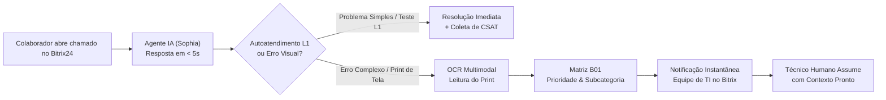
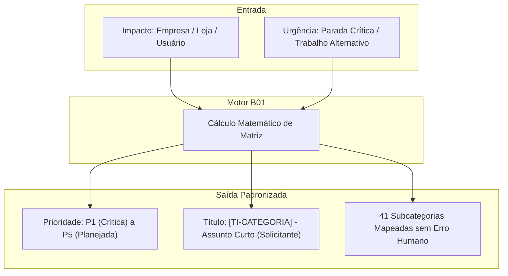
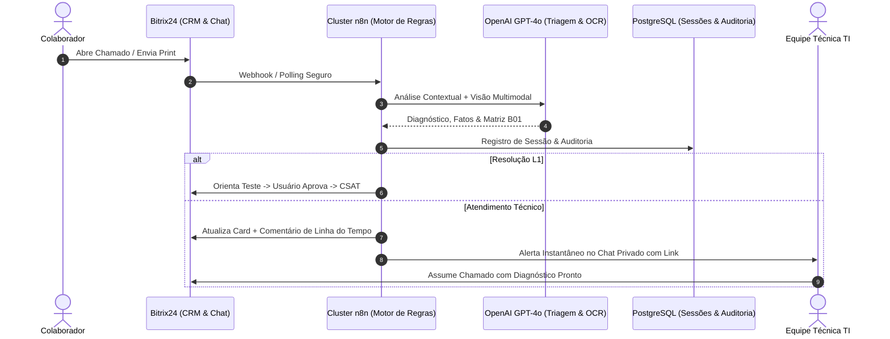
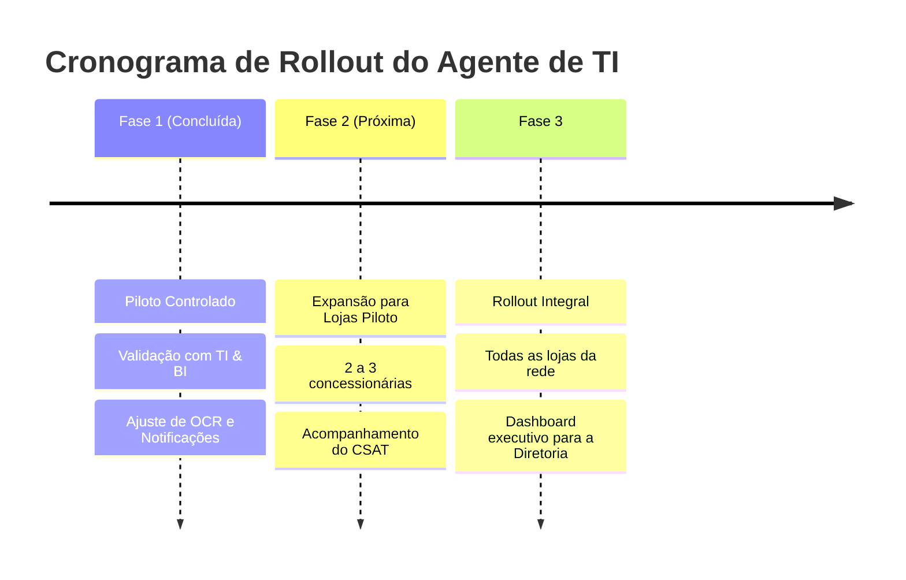

# Apresentação Executiva: Agente Inteligente de Serviços de TI (Sophia)
## Transformação Digital, Autoatendimento e Eficiência Operacional no Suporte da Rede Mundial Honda

---

> [!NOTE]
> **Público-Alvo:** Diretoria Executiva, Diretores de Operações e Lideranças Estratégicas  
> **Área:** Tecnologia da Informação & Governança de Processos  
> **Plataformas Integradas:** Bitrix24 CRM & Telefonia, Inteligência Artificial Generativa & Visão Computacional (OpenAI GPT-4o), Automação de Processos em Cluster Seguro (n8n & PostgreSQL)  
> **Data:** Outubro de 2026  

---

## 1. Resumo Executivo (Sumário para a Diretoria)

A expansão e o ritmo de atendimento das concessionárias da **Rede Mundial Honda** demandam disponibilidade contínua de sistemas (MicroWork Cloud, Portais Honda, RENAVE, emissão fiscal, internet e terminais de vendas/oficina). Historicamente, o canal de suporte de TI enfrentava os gargalos tradicionais de centrais de chamados:
* Aberturas com descrições genéricas (*"meu computador não funciona"*);
* Falta de triagem imediata por impacto no negócio;
* Acúmulo de tarefas repetitivas de primeiro nível sobre a equipe técnica;
* Dificuldade de identificar com agilidade chamados que impactam diretamente o cliente presente na loja.

Para sanar esses desafios, desenvolvemos o **Agente Inteligente de Serviços de TI**, uma solução pioneira baseada em Inteligência Artificial Generativa e Visão Computacional, integrada de forma nativa ao Bitrix24. 

O agente atua como um **primeiro nível ativo (L1)** que atende o colaborador em menos de 5 segundos, analisa prints de erro, orienta testes rápidos de auto-resolução, padroniza tecnicamente os dados e notifica a equipe de TI em tempo real para os casos que exigem intervenção humana especializada.

---

## 2. Diagnóstico Operacional: Antes x Depois

| Dimensão | Modelo Tradicional (Anterior) | Novo Modelo com o Agente de TI |
| :--- | :--- | :--- |
| **Tempo de Resposta Inicial** | De 30 minutos a várias horas (fila passiva) | **Instantâneo (< 5 segundos)** via chat interno do card |
| **Qualidade da Informação** | Descrições vagas sem detalhes de tela, loja ou sistema | **Padronizada via IA:** chassi, pedido, tela, código de erro e diagnóstico |
| **Leitura de Imagens / Prints** | O técnico precisava abrir o anexo, decifrar e reescrever | **OCR Computacional com IA:** leitura automática e precisa do erro na imagem |
| **Sensibilidade Comercial** | Chamados tratados por ordem de chegada, sem prioridade de venda | **Detector de 'Cliente em Loja':** elevação automática para prioridade máxima |
| **Resolução de Primeiro Nível** | 100% dos chamados demandavam hora técnica humana | **Autoatendimento guiado:** resolve problemas simples em minutos |
| **Solicitação de Compras** | Tramitação confusa por e-mail e mensagens soltas | **Aprovação em 1 clique:** botões interativos enviados à liderança |
| **Controle Pós-Chamado** | Usuários reutilizavam chamados antigos fechados ("carona") | **Bloqueio Anti-Carona:** orientação educativa e pesquisa CSAT (1 a 5 estrelas) |

---

## 3. Principais Capacidades da Ferramenta

### 3.1. Visão Computacional Multimodal (OCR Inteligente de Prints)
Colaboradores frequentemente enviam capturas de tela com erros complexos dos sistemas homologados. O agente conta com uma camada de Visão Computacional de última geração que:
* **Identifica o Sistema:** Reconhece visualmente MicroWork Cloud, Internet Honda System (IHS), WebPeças, RENAVE, Outlook, Windows ou impressoras.
* **Extrai Dados Críticos:** Captura códigos de erro exatos, números de OS, chassis de motocicletas e números de notas fiscais.
* **Diagnóstico Instantâneo:** Interpreta a mensagem na tela e já contextualiza o atendimento, sem perguntar ao colaborador o que a imagem já comprova.

> [!TIP]
> **Caso Real de Homologação:** No chamado piloto `#1406390`, o colaborador enviou um print sem digitar texto. O agente leu a imagem do portal IHS, identificou o alerta `(12.1) Usuário Bloqueado`, acolheu o usuário citando o sistema e direcionou a solicitação com todas as informações necessárias para desbloqueio imediato pela equipe técnica.

---

### 3.2. Detecção de Risco Comercial & Cliente em Loja
O agente monitora continuamente a linguagem do solicitante para identificar momentos críticos da operação comercial:
* **Presença de Cliente na Concessionária:** Menções a *"cliente esperando no balcão"*, *"cliente na mesa para retirar moto"* ou *"faturamento travado"* disparam elevação automática para prioridade máxima operacional (**P1**).
* **Frustração Elevada / Reincidência:** Casos com múltiplos relatos de lentidão são categorizados com urgência elevada para estancar o impacto na equipe de vendas.

---

### 3.3. Motor Determinístico de Prioridade (Matriz B01) & Governança de Campos
Para eliminar a subjetividade humana, a prioridade não é escolhida pelo usuário, mas calculada por um motor determinístico rigoroso:

$$\text{Prioridade (P1 a P5)} = \text{Impacto no Negócio} \times \text{Urgência Operacional}$$

* **Proteção de Layout:** O card do chamado no Bitrix24 foi dividido em duas seções blindadas:
  1. *Dados do Solicitante:* Apenas 5 campos essenciais preenchidos em menos de 60 segundos;
  2. *Gestão Técnica (TI):* Campos preenchidos exclusivamente pelo robô e pelos analistas de suporte, com edição inline travada contra cliques acidentais.

---

### 3.4. Fluxo Integrado de Solicitação e Aprovação de Compras
Quando a demanda envolve aquisição de periféricos, cabos, peças ou suprimentos:
1. O agente identifica a intenção de compra e pergunta formalmente se há equipamento reserva no setor para reaproveitamento;
2. Coleta o patrimônio e a justificativa operacional;
3. O chamado é movido para o estágio de cotação/aprovação;
4. **Mensagem Interativa com Botões:** O gestor responsável recebe no chat privado do Bitrix24 a notificação com os botões `[Aprovar Compra]`, `[Ver Chamado]` e `[Recusar]`, permitindo autorização em segundos pelo celular ou computador.

---

### 3.5. Autoatendimento de Primeiro Nível (L1) & Pesquisa CSAT
* **Solução Guiada:** Quando o problema envolve situações comuns (redefinição simples, impressora pausada, cabos frouxos, cache do navegador), o robô sugere um procedimento passo a passo seguro.
* **Pesquisa de Satisfação Integrada:** Ao confirmar a resolução, o robô encerra o chamado e convida o colaborador a avaliar o atendimento de 1 a 5 estrelas. Os dados são gravados em banco de dados gerencial para acompanhamento contínuo da qualidade.

---

### 3.6. Notificação Imediata para a Fila Técnica de TI
Assim que a triagem é finalizada e o chamado exige intervenção física ou acesso administrativo avançado:
* O robô dispara uma notificação direta no chat privado dos técnicos de plantão da TI;
* A mensagem traz o resumo consolidado, nível de prioridade, nome do solicitante, filial e link direto para o card no CRM.

---

## 4. Arquitetura Tecnológica e Segurança da Informação

### Pilares de Governança & LGPD:
1. **Política Estrita de Senhas:** O agente nunca solicita, manipula ou exibe senhas em texto no chat.
2. **Ambiente Seguro e Dedicado:** Execução de automações em cluster corporativo homologado com tráfego seguro criptografado (HTTPS/TLS).
3. **Mecanismo Anti-Carona:** Impede a reutilização desordenada de tickets concluídos, preservando o histórico e a rastreabilidade contábil e técnica de cada intervenção.

---

## 5. Indicadores de Sucesso & ROI para a Concessionária

| Indicador Estratégico | Meta com o Agente | Benefício Direto para a Diretoria |
| :--- | :---: | :--- |
| **SLA de Primeiro Atendimento** | **< 10 segundos** | Elimina a sensação de espera do colaborador nas lojas |
| **Taxa de Auto-Resolução (L1)** | **15% a 25%** | Dezenas de chamados resolvidos sem onerar a equipe técnica |
| **Economia de Horas Técnicas** | **~40 a 60h/mês** | Libera analistas para projetos estruturantes, redes e segurança |
| **Priorização Comercial (Vendas)** | **100% dos casos críticos** | Foco absoluto em problemas que travam vendas e entregas de motos |
| **Índice de Satisfação (CSAT)** | **> 4.5 / 5.0** | Aferição transparente da qualidade do suporte em todas as filiais |

---

## 6. Resultados do Piloto de Homologação

Durante a fase piloto controlada com a liderança de TI e BI:
* **Homologação L1 com Sucesso:** Chamado `#1406380` resolvido em autoatendimento pelo colaborador com nota máxima 5/5 na pesquisa CSAT.
* **Triagem de Print Completa:** Chamado `#1406390` com leitura visual precisa de bloqueio no sistema de motocicletas, título B01 gerado e notificação técnica disparada com sucesso.
* **Estabilidade Técnica:** Mais de 500 execuções do fluxo registradas com 100% de sucesso operacional e tempo de resposta estável.

---

## 7. Próximos Passos: Plano de Expansão (Rollout)

1. **Fase 2 (Expansão de Lojas):** Habilitar o agente para atendimento aos colaboradores de 3 concessionárias selecionadas por 15 dias.
2. **Fase 3 (Lançamento Geral):** Liberação para todas as concessionárias e departamentos administrativos da Rede Mundial Honda.
3. **Painel Gerencial Executivo:** Disponibilização de dashboard em tempo real para a Diretoria com volume de chamados por loja, sistemas mais problemáticos e índice de satisfação.

---

*Documento Executivo — Tecnologia da Informação & Inovação, Rede Mundial Honda.*
