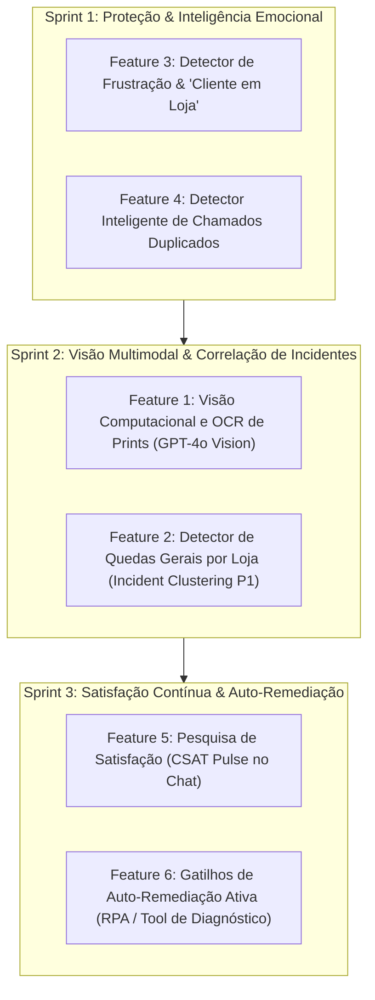

# 📘 Diário Oficial de Ajustes, Evolução e Melhorias da Plataforma RPA
**Mundial Honda — Cluster Corporativo de Automação Robótica de Processos**
*ERP MicroWork Cloud (DMS) • CRM Bitrix24 • Salesforce MyHonda • Web Cockpit BI & Infraestrutura 24/7*

---

> [!NOTE]
> **Finalidade deste Diário:**  
> Este documento é o **registro histórico definitivo e oficial** de todas as melhorias, refatorações arquiteturais, correções de incidentes, blindagens fiscais e otimizações de experiência de usuário desenvolvidas na plataforma RPA da **Mundial Honda** desde o início do projeto até o estágio atual de produção.  
> Qualquer novo ajuste, refatoração ou ampliação de robô deve ser adicionado cronologicamente a este diário.

---

## 📑 Sumário Executivo

1. [Visão Geral & Linha do Tempo Macro (Fases do Projeto)](#1-visão-geral--linha-do-tempo-macro-fases-do-projeto)
   * [Fase 0: Diagnóstico da Frota Legada e Dívida Técnica](#fase-0-diagnóstico-da-frota-legada-e-dívida-técnica)
   * [Fase 1: Padronização Estrutural e Isolamento de Instâncias](#fase-1-padronização-estrutural-e-isolamento-de-instâncias)
   * [Fase 2: Fundação da Arquitetura de Resiliência Corporativa](#fase-2-fundação-da-arquitetura-de-resiliência-corporativa)
   * [Fase 3: Rollout da Autoridade NEW_READ e Resgate de Fila](#fase-3-rollout-da-autoridade-new_read-e-resgate-de-fila)
   * [Fase 4: Modernização de Infraestrutura e Expurgo de Redundâncias](#fase-4-modernização-de-infraestrutura-e-expurgo-de-redundâncias)
   * [Fase 5: Blindagem de Sessão DMS MicroWork Cloud (Anti-HTTP 400)](#fase-5-blindagem-de-sessão-dms-microwork-cloud-anti-http-400)
   * [Fase 6: Cockpit Executivo, BI de Inconsistências e Evidências Forenses](#fase-6-cockpit-executivo-bi-de-inconsistências-e-evidências-forenses)
   * [Fase 7: Overhaul Panorâmico da Central de Leads MyHonda 2.0](#fase-7-overhaul-panorâmico-da-central-de-leads-myhonda-20)
   * [Fase 8: Blindagem Comercial & Integridade da Identidade dos Leads](#fase-8-blindagem-comercial--integridade-da-identidade-dos-leads)
   * [Fase 9: Prontidão para Servidor Dedicado & CI/CD Local](#fase-9-prontidão-para-servidor-dedicado--cicd-local)
   * [Fase 10: Central de Serviços TI (C160) — Triagem IA com PGVector, Fluxo de Compras & Autoatendimento Humanizado](#fase-10-central-de-serviços-ti-c160--triagem-ia-com-pgvector-fluxo-de-compras--autoatendimento-humanizado)
2. [Evolução e Ajustes Específicos por Robô / Módulo](#2-evolução-e-ajustes-específicos-por-robô--módulo)
   * [2.1. Robô Entrada Grupo (dms_entrada_grupo — C146)](#21-robô-entrada-grupo-dms_entrada_grupo--c146)
   * [2.2. Robô Vigia / Transferência de Veículos (dms_vigia — C24)](#22-robô-vigia--transferência-de-veículos-dms_vigia--c24)
   * [2.3. Robô Entrada Honda (dms_entrada_honda — C122)](#23-robô-entrada-honda-dms_entrada_honda--c122)
   * [2.4. Robô Entrada Fornecedores Terceiros (dms_entrada_terceiros — C144)](#24-robô-entrada-fornecedores-terceiros-dms_entrada_terceiros--c144)
   * [2.5. Robô Faturamento Venda Direta (dms_fat_direto — C24)](#25-robô-faturamento-venda-direta-dms_fat_direto--c24)
   * [2.6. Robô Faturamento Peças Grupo (dms_fat_grupo — C146)](#26-robô-faturamento-peças-grupo-dms_fat_grupo--c146)
   * [2.7. Robô Supervisor MyHonda 2.0 (crm_myhonda — Salesforce / Bitrix)](#27-robô-supervisor-myhonda-20-crm_myhonda--salesforce--bitrix)
   * [2.8. Núcleo Core, Servidores Web & Redes](#28-núcleo-core-servidores-web--redes)
   * [2.9. Central de Serviços TI & Agente de Triagem n8n (BITRIX_TI_AI_TRIAGE_AGENT — C160)](#29-central-de-serviços-ti--agente-de-triagem-n8n-bitrix_ti_ai_triage_agent--c160)
3. [Matriz Comparativa de Resultados (Antes vs Depois)](#3-matriz-comparativa-de-resultados-antes-vs-depois)
4. [Governança da Suíte de Testes Automatizados](#4-governança-da-suíte-de-testes-automatizados)
5. [Guia de Operação, Contingência & Manutenção](#5-guia-de-operação-contingência--manutenção)
6. [Evolução Central de TI: Agente de Help Desk Inteligente (Bitrix24 C160 & n8n RAG)](#6-evolução-central-de-ti-agente-de-help-desk-inteligente-bitrix24-c160--n8n-rag)
7. [Evolução Central de RH: Agente de IA para Recrutamento e Seleção (Bitrix24 C198 & WhatsApp Evolution API)](#7-evolução-central-de-rh-agente-de-ia-para-recrutamento-e-seleção-bitrix24-c198--whatsapp-evolution-api)
   * [7.1. Sprint 1: Estabilização de Pipeline, Sincronização de Vagas & Blindagem de Identidade](#71-sprint-1-estabilização-de-pipeline-sincronização-de-vagas--blindagem-de-identidade)
   * [7.2. Sprint 2: Handover Inteligente para o RH (Trilhas 2, 3 e 4)](#72-sprint-2-handover-inteligente-para-o-rh-trilhas-2-3-e-4)
   * [7.3. Sprint 3: Pós-Atendimento Inteligente & Blindagem de Estado (Anti-Interferência Humana)](#73-sprint-3-pós-atendimento-inteligente--blindagem-de-estado-anti-interferência-humana)

---

## 1. Visão Geral & Linha do Tempo Macro (Fases do Projeto)

### Fase 0: Diagnóstico da Frota Legada e Dívida Técnica
* **Cenário Inicial:** A automação era composta por scripts Python isolados e executáveis legados (`.exe`) sem comunicação entre si.
* **Principais Fragilidades Diagnosticadas:**
  1. *Polling Cego:* Robôs consultavam o Bitrix e o ERP em loops contínuos sem controle de transações ou estado persistente.
  2. *Cegueira de Descoberta:* O robô de Entrada Grupo filtrava cards pelo campo de texto `"Descrição"` (`UF_CRM_1729774515200`). Se o campo contivesse qualquer texto prévio, o card tornava-se invisível permanentemente para a esteira.
  3. *Insegurança Fiscal:* Ausência de checagem real pós-salvamento no ERP MicroWork. Se a conexão oscilasse no clique de "Salvar", o robô podia marcar o card como faturado sem que a NF estivesse autorizada na SEFAZ.
  4. *Concorrência de Instâncias:* Múltiplos robôs tentavam abrir o Google Chrome utilizando a mesma pasta de perfil de usuário, gerando erros de `user-data-dir in use` e travamento de portas.
  5. *Acúmulo Descontrolado de Arquivos:* Centenas de capturas de tela `.jpeg` e `.png` eram salvas a cada clique operacional, consumindo dezenas de gigabytes de disco rígido desnecessariamente.

---

### Fase 1: Padronização Estrutural e Isolamento de Instâncias
* **Reestruturação do Repositório:** Organização no diretório padrão `C:\Mundial_RPA` com subdivisão limpa em:
  * `apps/`: Robôs de negócio individuais.
  * `core/`: Camadas comuns de resiliência, APIs do Bitrix, Selenium seguro e servidores web.
  * `tests/`: Bateria de testes automatizados unitários e de integração.
  * `scripts/`: Utilitários de implantação e scripts batch.
  * `data/`: Bancos de dados de estado SQLite, métricas e chaves de túnel.
* **Isolamento de Perfis Chrome:** Cada robô recebeu um perfil dedicado em disco (`C:\AutomacaoChrome_*`).
* **Função Anti-Lock (`liberar_perfil_chrome`):** Varredura de processos via `psutil`, encerramento seletivo de instâncias órfãs de `chrome.exe` e eliminação segura do arquivo de trava `SingletonLock`.
* **Codificação Universal:** Padronização de terminais Windows em UTF-8 sem BOM (`chcp 65001`), evitando erros de interpretação no `cmd.exe` do Windows Server.

---

### Fase 2: Fundação da Arquitetura de Resiliência Corporativa
Criação do pacote [`core/resilience/`](file:///C:/Mundial_RPA/core/resilience/) para garantir execução determinística e tolerância zero a inconsistências fiscais:
* **`SqliteExecutionStateStore` (Modo WAL):** Persistência atômica com suporte a concorrência multi-thread e multi-processo através de *Write-Ahead Logging* e timeout de lock configurado.
* **Leases Atômicos com Heartbeat:** Robôs reivindicam um card com lease de 600 segundos (`CLAIMED`), renovando periodicamente (`PROCESSING`). Se um robô morrer abruptamente, o lease expira sem corromper o banco.
* **Proteção Anti-TOCTOU (*Time-of-Check to Time-of-Use*):** Readback obrigatório na API do Bitrix24 imediatamente antes de executar qualquer clique no MicroWork Cloud para checar se o card não foi alterado ou cancelado por operador humano.
* **Verificação Empírica de Pós-Condição:** Uma ação nunca é considerada concluída pelo simples clique em "Salvar". O robô navega até a grade fiscal (ex: Rotina 1719) e valida a presença da linha exata contendo `Número da NF + Razão Social Mundial + Situação CONCLUÍDO`.
* **Classificação de Erros & Quarentena Determinística:** Distinção estrita entre erros transientes (rede/timeout) e erros de negócio (falta de pátio, NF já lançada, item sem localização). Erros de negócio são isolados em Quarentena com Circuit Breaker `OPEN`, impedindo retentativas inúteis.

---

### Fase 3: Rollout da Autoridade NEW_READ e Resgate de Fila
* **Eliminação do Filtro Cego de Descrição:** O discovery no Bitrix passou a consultar unicamente `STAGE_ID="C146:NEW"` e `CATEGORY_ID=146`, transferindo a governança de elegibilidade integralmente para o StateStore SQLite.
* **Resgate do Card `#1378450`:** Card crítico que estava oculto há dias na esteira de Entrada Grupo foi imediatamente descoberto, processado e faturado com sucesso.
* **Homologação em Lotes Controlados:**
  * **Lote F3.1 (10 cards):** Processamento com 100% de sucesso, validação na Rotina 1719 e atualização de comentários no Bitrix.
  * **Lote F3.2 (9 cards):** Drenagem completa da fila acumulada sem nenhuma intervenção manual.
* **Fim do Loop de Devolução do Bitrix (600s):** Bloqueio definitivo no StateStore de devoluções automáticas causadas por gatilhos da pipeline `C146:UC_5SOHJG`.

---

### Fase 4: Modernização de Infraestrutura e Expurgo de Redundâncias
* **Descontinuação Definitiva do Google Firebase Firestore:**
  * Remoção completa da dependência pesada `firebase-admin` e do script legado `sync_firebase.py`.
  * Toda a telemetria, autenticação e visualização foram consolidadas localmente no Dashboard Flask nativo (`dashboard.py` e `painel_web.py`).
* **Expurgo de Mais de 150 MB de Lixo Tecnológico:**
  * Exclusão de pastas de descompilação de `.exe` legados (`Myhonda1_0.exe`, `Myhonda2_1.exe`).
  * Remoção de binários duplicados do `cloudflared.exe`, mantendo uma única versão centralizada em `tools/cloudflared.exe`.
  * Remoção do deploy legado da Vercel (`PUBLICAR_VERCEL.bat`, `vercel.json`).
* **Infraestrutura Híbrida de Túneis com SSL Wildcard Permanente:**
  * Implantação de túneis reversos via SSH com a VPS Hostinger (`hostinger_tunnel.py`), provendo acesso rápido e estável com certificado SSL para:
    * `https://central-rpa.timft8.easypanel.host` (Central Unificada - Porta 5050)
    * `https://myhonda.timft8.easypanel.host` (Cockpit MyHonda - Porta 5000)
  * Resolução de permissões NTFS na chave privada SSH (`icacls`) e forçamento de encaminhamento para IPv4 numérico (`127.0.0.1`), sanando erros de `502 Bad Gateway`.
  * Criação do [`tunnel_watchdog.py`](file:///C:/Mundial_RPA/core/tunnel_watchdog.py) para checagem ativa a cada 30s com autorrecuperação.
* **Topologia Multi-Máquinas (PC Dev vs Servidor Produção):**
  * Suporte a `.env.local` para desativar abertura de túnel no computador de desenvolvimento (`ENABLE_PUBLIC_TUNNEL=false`), evitando que comandos disparados no link público fossem acidentalmente executados no computador de desenvolvimento em vez do servidor.
  * Exibição em tempo real do Hostname e IP da máquina no cabeçalho do Dashboard com badge de ambiente (**🟢 PRODUÇÃO** vs **🟡 LOCAL / DEV**).

---

### Fase 5: Blindagem de Sessão DMS MicroWork Cloud (Anti-HTTP 400)
* **Diagnóstico Forense de Incidente Crítico:**
  * O robô Faturamento Peças Grupo e demais robôs DMS começaram a apresentar loop infinito ao carregar telas do MicroWork Cloud, com erro `TimeoutException` na grade Kendo UI.
  * *Causa Raiz:* O IdentityServer do MicroWork Cloud acumulava cookies `OpenIdConnect.nonce.*` (~390 bytes cada) a cada navegação. Após alguns dias, a requisição atingia mais de 16 KB de cabeçalho, sendo rejeitada pelo servidor IIS com `HTTP Error 400: Bad Request - Request Too Long`. A página Angular redirecionava silenciosamente para `#/account/unauthenticated`.
* **Solução Definitiva:**
  * Criação da rotina `limpar_cookies_openid_bloat()` utilizando o Chrome DevTools Protocol (CDP `Network.deleteCookies`) com fallback nativo no Selenium.
  * Higienização preventiva executada no boot do navegador, antes de navegar e logo após o login.
  * Detecção ampla de telas desautenticadas (`#/account/unauthenticated`, `Bad Request`, `Request Too Long`), com purga de storage local e auto-relogin imediato.
  * Blindagem padronizada em todos os 6 robôs DMS.

---

### Fase 6: Cockpit Executivo, BI de Inconsistências e Evidências Forenses
* **Central de Rastreabilidade E2E & Jornada do Card:**
  * Rastreamento passo a passo da jornada operacional: *Captura do Card -> Validação no CRM -> Alocação/Lançamento no ERP -> Pós-condição Fiscal -> Atualização no Bitrix*.
* **Captura de Evidências Forenses (Prints do ERP + JSON):**
  * Módulo dedicado em [`core/forensics/`](file:///C:/Mundial_RPA/core/forensics/) que captura automaticamente a imagem da tela do MicroWork Cloud no momento exato em que um erro de negócio ou trava de pátio/chassi ocorre.
  * Gravação do espelho em JSON com URL da tela, título, mensagem de erro, timestamp e dados da proposta.
* **Interatividade no Dashboard Web (Porta 5050):**
  * Modais clicáveis para visualização de evidências visuais do ERP em alta resolução.
  * Exibição completa de dados fiscais (Número da NF-e, Valor do Documento, Chave de Acesso SEFAZ de 44 dígitos, Emitente e Destinatário).

---

### Fase 7: Overhaul Panorâmico da Central de Leads MyHonda 2.0
* **Resgate Integral da Base Histórica de 6.130 Leads:**
  * Correção do truncamento estático que limitava a exibição aos 3.000 registros mais recentes no arquivo `dashboard.py`.
  * Restauração da visibilidade de leads históricos de Julho, Agosto, Setembro e Outubro/2026.
* **Filtros Flexíveis por Período Digitado:**
  * Adição de campos de data `De: [AAAA-MM-DD]` e `Até: [AAAA-MM-DD]` com filtragem instantânea via JavaScript sem recarregar a página.
  * Botões de atalho rápido para meses completos: `Agosto/2026`, `Setembro/2026`, `Outubro/2026` e `Todos`.
* **Ergonomia e Redesenho de Layout:**
  * Expansão da largura útil em **+440 pixels** (container ampliado para `max-w-[1720px]`).
  * Redução dos espaçamentos laterais para maximizar a área da grade.
  * Coluna de "Ações" fixada à direita (`sticky right-0 bg-slate-900 shadow-xl`), garantindo acesso rápido aos botões operacionais.
  * Adição de botões de rolagem lateral (no topo da tabela e botões flutuantes nas bordas da tela) com navegação suave para monitores com qualquer resolução.

---

### Fase 8: Blindagem Comercial & Integridade da Identidade dos Leads
* **Blindagem Anti-Perda de Telefones Secundários (Ticket #1380498):**
  * *Problema:* Quando um cliente cadastrava uma segunda proposta retificando seu número de telefone, o robô MyHonda identificava que o lead já existia e ignorava o novo número. Como consequência, o consultor ligava para o número antigo (ou errado).
  * *Solução:* O telefone mais recente é **SEMPRE promovido a TELEFONE PRINCIPAL** (índice 0) no Contato do Bitrix24, enquanto os números anteriores são preservados como **SECUNDÁRIOS**.
* **Atualização Dinâmica de Identidade (Caso Bruno / Melissa):**
  * *Problema:* Quando familiares ou cônjuges preenchiam propostas usando o telefone de um cadastro já existente, o negócio era criado com o nome da nova proposta, mas o Contato no Bitrix mantinha o nome da pessoa antiga.
  * *Solução:* Atualização automática e atômica dos campos `NAME` e `LAST_NAME` do Contato para o nome da pessoa mais recente, inclusão de novos e-mails como secundários e preservação do histórico.
* **🛡️ REGRA DE OURO INVIOLÁVEL DA CARTEIRA COMERCIAL:**
  * O campo `ASSIGNED_BY_ID` (**Consultor Comercial Responsável**) **NUNCA** é alterado durante as atualizações de identidade.
  * Verificação pós-condição em código: caso a API do Bitrix altere o responsável involuntariamente, o robô detecta a divergência e restaura o ID do vendedor original de forma atômica.
* **Auditoria na Linha do Tempo de Negócios e Contatos:**
  * Registro de comentários automáticos e explicativos na timeline tanto do Negócio quanto do Contato detalhando as alterações cadastrais para transparência total da equipe comercial.
* **Sincronização Retroativa:** Execução de scripts dedicados de varredura que auditaram e corrigiram cadastros dos últimos meses em produção.

---

### Fase 9: Prontidão para Servidor Dedicado & CI/CD Local
* **Pacote de Dependências Oficial (`requirements.txt`):**
  * Homologação e inclusão de todas as 22 bibliotecas essenciais com versões exatas e testadas (Selenium CDP, Undetected Chromedriver, Webdriver Manager, Flask, Waitress, Werkzeug, Requests, Pandas, OpenPyXL, Pillow, Cryptography, Psutil, Dateutil, Tzdata, Colorama, Certifi).
* **Instalador Automático com 1 Clique ([`INSTALAR_DEPENDENCIAS.bat`](file:///C:/Mundial_RPA/INSTALAR_DEPENDENCIAS.bat)):**
  * Valida instalação do Python 3.10+ e do Google Chrome.
  * Atualiza o `pip` e instala todas as dependências em modo limpo.
  * Executa automaticamente a suíte de testes completa ao final, liberando o servidor apenas se tudo estiver 100% aprovado.
* **Manual Completo de Implantação ([`LEIAME_MIGRACAO_SERVIDOR.md`](file:///C:/Mundial_RPA/LEIAME_MIGRACAO_SERVIDOR.md)):**
  * Guia passo a passo para clonagem, configuração de variáveis `.env`, inicialização 24/7 e configuração do Agendador de Tarefas do Windows.
* **Suíte de Testes Expandida:** 53 testes automatizados cobrindo resiliência, transições de estado, autoridade new-read, desautenticação OpenID e preservação de vendedores (53/53 PASS).

---

### Fase 10: Central de Serviços TI (C160) — Triagem IA com PGVector, Fluxo de Compras & Autoatendimento Humanizado
* **Cenário:** Implantação e consolidação da Central de Serviços e Atendimento de TI (Pipeline Categoria 160 do Bitrix24), integrando agente autônomo em n8n (`BITRIX_TI_AI_TRIAGE_AGENT`), banco vetorial PostgreSQL (`pgvector`), workflows de decisão e esteira unificada de governança.
* **Marcos e Entregas Consolidadas:**
  1. *RAG & Base Vetorial Dinâmica no PostgreSQL (`kb_ti_conhecimento`):*
     - Modelagem da tabela `kb_ti_conhecimento` com embeddings gerados via OpenAI (`text-embedding-3-small`).
     - Carga oficial de 13 POPs operacionais completos da TI (`KB-001` a `KB-014`), cobrindo MicroWork, RENAVE, impressoras, rede, computadores e portais Honda.
     - Acoplamento da ferramenta `KB_TI_PGVector_Tool` ao nó `08_AI_Agent_Triage_Deal` do n8n, garantindo 100% de acurácia na recuperação semântica durante os diálogos com os colaboradores.
  2. *Esteira Unificada de Compras de TI (Sem Pipeline Filha):*
     - Manutenção da regra de ouro de negócio: todos os chamados permanecem na Categoria 160.
     - Roteamento inteligente: chamados com tema de compra, categoria 876 ou identificados pelo cérebro da IA são movidos automaticamente para a etapa **Aguardando autorização** (`C160:UC_JIOBG8`).
     - Criação do campo customizado `UF_CRM_TI_RESPONSIBLE` (ID `1796`, tipo `employee`, "Responsável TI") no layout da Categoria 160, gravando o responsável pela ação de aprovação/rejeição.
  3. *Workflow Webhook de Aprovação Interativa (`BITRIX_TI_PURCHASE_APPROVAL_HANDLER`):*
     - Criação do workflow dedicado `uRjdQlM8edLyKmQO` no n8n.
     - Disparo de botões interativos via Bitrix IM API (`im.message.add` com parâmetro `KEYBOARD`).
     - **Resolução da Tela Preta:** Substituição do response cru em JSON (`{"success":true}`) por nó oficial `Respond to Webhook` renderizando HTML moderno, responsivo, com status colorido, identificação do chamado e auto-redirecionamento com contador de 3s para o card no Bitrix24.
  4. *Blindagem de Segurança no Envio de Botões:*
     - Expurgo total de botões de aprovação do chat do ticket (evitando que o solicitante aprove sua própria compra).
     - Envio dos 3 botões interativos (`[ ✅ Autorizar Compra ]`, `[ 💬 Falar no Chamado ]`, `[ ❌ Negar ]`) **exclusivamente** para o chat privado 1:1 dos aprovadores (Eduardo Alaminos / Zélia Silva).
  5. *Inteligência Preventiva da Diretoria (Diretiva Zélia Silva - Controladoria):*
     - Injeção mandatória no prompt do AI Agent para perguntar preventivamente ao colaborador: *"Você chegou a verificar no seu setor ou com a liderança se há algum equipamento ou peça reserva disponível para reaproveitamento ou substituição?"*.
     - Gravação explícita da resposta no Resumo Técnico do CRM, eliminando retrabalho da Diretoria antes de autorizar.
  6. *Humanização da Experiência e Protocolo "Do It Yourself" (DIY Acolhedor):*
     - Substituição da saudação fria e corporativa por mensagem calorosa, chamando pelo primeiro nome, contextualizada pelo título do card e convidando ao envio de fotos/prints.
     - Diretriz estrita de linguagem: proibição de "tecniquês" (driver, spooler, DHCP, DNS, etc.), explicações por pistas visuais (cores de cabos, caixinha do PC, botões) e encerramento gentil caso o colaborador sinta receio de mexer.
  7. *Protocolo de P?s-Atendimento e Filtro Anti-Carona (Homologado em Produ??o):*
     - Implementa??o do subsistema `PostRes` no n8n (`c0F2GUMFm2BI94UG`) com classifica??o via LLM (OpenAI GPT-4.1-mini) e janela de escuta de 7 dias p?s-fechamento.
     - Tratamento at?mico dos 3 cen?rios:
       - `THANKS`: Retorno cort?s mantendo o chamado Ganho (`C160:WON`).
       - `REOPEN`: Reabertura autom?tica para `C160:PREPARATION` ("Em atendimento"), registro de evid?ncia na timeline e handover seguro para a equipe t?cnica (`AI_PAUSED`).
       - `CARONA`: Bloqueio educado no chat orientando abertura de novo chamado no Bitrix24, preserva??o de integridade do chamado em `C160:WON` e anota??o na timeline.
     - Homologado em teste real no Card `#1402306` (Eduardo Alaminos) e `#1396046`.

---

## 2. Evolução e Ajustes Específicos por Robô / Módulo

### 2.1. Robô Entrada Grupo (`dms_entrada_grupo` — C146)
* **Arquivo Principal:** [`apps/dms_entrada_grupo/Lancamento_entradagrupo.py`](file:///C:/Mundial_RPA/apps/dms_entrada_grupo/Lancamento_entradagrupo.py)
* **Autoridade New-Read:** Substituição completa do filtro `"UF_CRM_1729774515200": ""` pela governança atômica do StateStore.
* **Pós-Condição na Rotina 1719:** Varredura da grade de XML de Entrada exigindo XPath com tupla exata `(Número NF + Razão Mundial + CONCLUÍDO)`.
* **Tratamento de Itens Sem Localização:** Preenchimento automático de `SEM LOCAL` e clique em processar quando a grade do ERP solicitar localização obrigatória de itens de estoque.
* **Tratamento de Exigência de Pátio:** Encaminhamento imediato para quarentena técnica `C146:UC_3EXR6L` ("Falta Carga") com comentário explicativo para o operador e circuito `OPEN`.
* **Correção de Escopo de Variáveis:** Correção de `UnboundLocalError` em `processed_in_batch` através de escopo global.

---

### 2.2. Robô Vigia / Transferência de Veículos (`dms_vigia` — C24)
* **Arquivos Principais:** [`apps/dms_vigia/Transferencia_Veiculos.py`](file:///C:/Mundial_RPA/apps/dms_vigia/Transferencia_Veiculos.py) e [`apps/dms_vigia/Vigia_Unificado.py`](file:///C:/Mundial_RPA/apps/dms_vigia/Vigia_Unificado.py)
* **Detecção Automática da Versão do Chrome:** Leitura dinâmica da chave de Registro do Windows (`HKCU\Software\Google\Chrome\BLBeacon`), tornando a inicialização com Undetected ChromeDriver imune a updates automáticos do navegador.
* **Navegação no Formulário Angular MicroWork:** Disparo determinístico de **8 teclas TAB** a partir do campo `Vendedor` para posicionar o cursor no campo `Pessoa`, eliminando confusão de seletores.
* **Busca Inteligente de Filiais:** Reconhecimento automático do CNPJ e aliases da filial Sumaré (`SUM` / `03358492000...`).
* **Tratamento de Ficha Já Alocada:** Quando o chassi já possui ficha aberta, o robô detecta a mensagem, pula a etapa de proposta e navega diretamente para `/veiculo/proposta` para dar andamento à liberação e faturamento.
* **Fechamento de Pedidos em Aberto:** Tratamento de pedidos com status "ABERTA" através do menu de opções (ícone da engrenagem -> "Alterar" -> "Fechar Pedido").
* **Superação de Alertas de Preço:** Detecção de modal amarelo ("Preço abaixo da tabela") e acionamento de segundo clique de confirmação.
* **Auditoria e Download na Rotina 940:** Conferência milimétrica por colunas (Empresa, Data de Emissão = Hoje, Número da NF, Natureza de Transferência) e anexo do PDF da NF tanto no campo de arquivo nativo (`UF_CRM_1735304929`) quanto na timeline do Bitrix.

---

### 2.3. Robô Entrada Honda (`dms_entrada_honda` — C122)
* **Arquivo Principal:** [`apps/dms_entrada_honda/Lancamento_Entrada_Honda.py`](file:///C:/Mundial_RPA/apps/dms_entrada_honda/Lancamento_Entrada_Honda.py)
* **Mapeamento de CFOPs Especiais:** Suporte nativo a notas fiscais de fábrica com CFOP `5910` e `6910` (remessas em garantia e bonificações promocionais).
* **Tratamento de Substituição Tributária (ST):** Espera explícita pela finalização do cálculo de ST (`div.k-loading-mask` invisível) antes de efetuar o clique em Salvar.
* **Primitiva de Clique Seguro:** Implementação de retentativas em elementos com sobreposição e fallback para clique via JavaScript.
* **Auto-Consolidação de Contas a Pagar & Resolução de Bloqueio Prematuro:**
  - Implementação de `consolidar_contas_a_pagar()` com expansão automática de `#GroupPacelasContasPagar`, inspeção de títulos em `#GridContaPagar_0`, seleção de Portador via Kendo UI ComboBox em `#GridParcelas` e salvamento completo da seção.
  - Reestruturação do fluxo de salvamento: execução preventiva para notas de mercadoria (movimento 2) e reposicionamento de `checar_erro_e_tratar()` para atuar como motor de auto-resolução antes e após o salvamento, eliminando falsos positivos na etapa `C122:UC_NCVKBH`.
  - Atualização do log e timeline do Bitrix registrando as correções automáticas aplicadas com sucesso.

---

### 2.4. Robô Entrada Fornecedores Terceiros (`dms_entrada_terceiros` — C144)
* **Arquivo Principal:** [`apps/dms_entrada_terceiros/Lancamento_Terceiro.py`](file:///C:/Mundial_RPA/apps/dms_entrada_terceiros/Lancamento_Terceiro.py)
* **Matriz Ampla de CFOPs:** Suporte a compras com CFOPs `5101`, `5102`, `5405`, `6101` e `6102` com múltiplos itens e alíquotas mistas.
* **Gerenciamento Seguro de Abas:** Controle de janelas do navegador com `driver.window_handles` para abertura de espelhos de notas e retorno garantido à janela principal.
* **Notas Sem Duplicata & Blindagem de Modais Contas a Pagar:** Restrição estrita de `checar_erro_modal()` à janela ativa (`.k-window`), eliminando falsos positivos originados de avisos transitórios do formulário principal de fundo ("vínculo com contas a pagar", "centro de resultado" e avisos estáticos de localização) durante o fluxo do gerador de parcelas.


---

### 2.5. Robô Faturamento Venda Direta (`dms_fat_direto` — C24)
* **Arquivo Principal:** [`apps/dms_fat_direto/fatdireto.py`](file:///C:/Mundial_RPA/apps/dms_fat_direto/fatdireto.py)
* **Validação Fiscal de Faturamento:** Consulta à Rotina 940 garantindo que a nota fiscal foi autorizada na SEFAZ antes de promover o negócio comercial no Bitrix24.
* **Prevenção de Faturamentos Concorrentes:** Checagem de status de emissão da NF para evitar cancelamento indevido ou duplicidade.

---

### 2.6. Robô Faturamento Peças Grupo (`dms_fat_grupo` — C146)
* **Arquivo Principal:** [`apps/dms_fat_grupo/Fat-Grupo.py`](file:///C:/Mundial_RPA/apps/dms_fat_grupo/Fat-Grupo.py)
* **Resolução de Dropdown Kendo Angular:** Mapeamento de aliases de filiais (`PINHAL`, `ESPÍRITO SANTO`, `CONCHAL`) e fechamento forçado via tecla `ESCAPE` caso o dropdown não localize a opção, evitando sobreposição em tela.
* **Saneamento de Capturas de Tela:** Desativação do salvamento incondicional de fotos em disco, restringindo a captura de telas estritamente a blocos de exceção (`erro_*.png`).

---

### 2.7. Robô Supervisor MyHonda 2.0 (`crm_myhonda` — Salesforce / Bitrix)
* **Arquivos Principais:** [`apps/crm_myhonda/src/supervisor.py`](file:///C:/Mundial_RPA/apps/crm_myhonda/src/supervisor.py), [`apps/crm_myhonda/src/Myhonda2_1.py`](file:///C:/Mundial_RPA/apps/crm_myhonda/src/Myhonda2_1.py) e [`apps/crm_myhonda/src/dashboard.py`](file:///C:/Mundial_RPA/apps/crm_myhonda/src/dashboard.py)
* **Captura Contínua 24/7:** Extração de leads da montadora, resolução de rodízio de consultores por loja e criação de Negócios e Contatos no Bitrix24.
* **Priorização do Telefone Mais Recente:** Reordenação atômica de multifields telefônicos no Bitrix24 promovendo o número mais novo a principal e mantendo os antigos como secundários.
* **Atualização Dinâmica de Identidade:** Renomeação imediata de contatos familiares (ex: Melissa / Bruno) com preservação da integridade da carteira comercial.
* **Preservação Inviolável de Vendedor:** Trava de código com readback imediato que garante que o consultor original (`ASSIGNED_BY_ID`) permaneça dono do lead.
* **Central de Leads:** Frontend com filtros por período digitado, atalhos por mês, visualização em alta densidade (+440px) e controles de rolagem lateral.

---

### 2.8. Núcleo Core, Servidores Web & Redes
* **Servidor Central RPA (Porta 5050):** Interface unificada de controle com disparo individual, em lote, telemetria de hardware e monitoramento de túneis.
* **Gateway VPS Hostinger:** Roteamento reverso seguro com SSL wildcard permanente para acesso externo via navegador ou celular.
* **EventBus Reativo & Rastreabilidade:** Módulos em [`core/event_bus.py`](file:///C:/Mundial_RPA/core/event_bus.py) e [`core/traceability.py`](file:///C:/Mundial_RPA/core/traceability.py) para auditoria ponta a ponta dos cards.
* **Forensics Visual:** Captura e exibição de prints do ERP e espelhos JSON para investigação de inconsistências operacionais.

---

### 2.9. Central de Serviços TI & Agente de Triagem n8n (BITRIX_TI_AI_TRIAGE_AGENT — C160)
* **Objetivo:** Atendimento de primeiro nível (L1) automatizado, triagem e resolução de incidentes internos para centenas de colaboradores das concessionárias Mundial Honda via chat do Bitrix24.
* **Componentes Arquiteturais:**
  * Workflow Canônico Principal: `c0F2GUMFm2BI94UG` (`BITRIX_TI_AI_TRIAGE_AGENT`).
  * Workflow de Aprovação de Compras: `uRjdQlM8edLyKmQO` (`BITRIX_TI_PURCHASE_APPROVAL_HANDLER`).
  * Tabela de Sessões no Postgres: `ticket_bot_sessions` (controle atômico de estado de conversação e chat).
  * Tabela de Procedimentos no Postgres: `kb_ti_conhecimento` (RAG Vetorial com PGVector).
* **Melhorias de Destaque:**
  * *Auto-Redirecionamento UX:* Redirecionamento instantâneo em 3 segundos pós-aprovação de compras direto para o card do CRM.
  * *Segurança Operacional:* Separação hermética entre canal de solicitação (colaborador leigo) e canal de decisão executiva (privado de gestores).
  * *Rastreabilidade Total:* Gravação pericial de Responsável TI (`UF_CRM_TI_RESPONSIBLE`), comentários de timeline e notas fiscais de peças.

---

## 3. Matriz Comparativa de Resultados (Antes vs Depois)

| Dimensão / Indicador | Estado Anterior (Legado) | Estado Atual (Plataforma Resiliente) | Impacto no Negócio |
| :--- | :--- | :--- | :--- |
| **Estabilidade da Fila** | Cards invisíveis por sujeira em campos de texto | Descoberta pura e StateStore atômico | 100% dos cards são processados sem perda |
| **Integridade Fiscal** | Risco de marcar card sem NF real autorizada | Pós-condição na Rotina 1719 / 940 | Risco zero de inconsistência contábil |
| **Sessão do ERP MicroWork** | Quedas diárias por estouro de cookies HTTP 400 | Higienização preventiva CDP e auto-relogin | Operação contínua 24/7 sem intervenção |
| **Gerenciamento de Navegador** | Travamento de perfis e conflito com Chrome 154 | Isolamento de perfis e autodetecção de versão | Boot instantâneo e livre de erros |
| **Carteira Comercial** | Risco de perda de vendedor ao retificar lead | Vendedor protegido com trava pós-condição | Governança comercial e comissões 100% blindadas |
| **Qualidade do Contato** | Telefones antigos geravam chamadas perdidas | Telefone mais recente sempre promovido a principal | Aumento na taxa de conversão e contato com lead |
| **Infraestrutura e Acesso** | Links temporários com queda constante (HTTP 503) | Túnel Hostinger / Cloudflare permanente com SSL | Acesso estável e seguro de qualquer lugar |
| **Armazenamento em Disco** | Milhares de capturas consumindo dezenas de GBs | Captura inteligente apenas em exceções reais | Economia substancial de disco e logs limpos |
| **Confiabilidade do Código** | Sem testes automatizados | 53 testes automatizados contínuos | Regressões bloqueadas antes de ir para produção |

---

## 4. Governança da Suíte de Testes Automatizados

A plataforma conta com uma bateria de testes rigorosa executada a cada alteração:

```cmd
python -m unittest discover -s tests -p "test_*.py"
```

### Composição dos Testes (53 Testes de Produção):
1. **`test_resilience_foundation.py`:** Testes de concorrência SQLite WAL, aquisição atômica de leases, expiração de leases e isolamento de processos.
2. **`test_resilience_hardening.py`:** Testes de proteção Anti-TOCTOU, validação de transições de estados válidas e controle de circuit breaker.
3. **`test_resilience_f23_reopen_and_canary.py`:** Testes de reabertura manual de geração e orçamento de canário.
4. **`test_resilience_f3_rollout.py`:** Testes da autoridade New-Read em lotes de cards e tratamento de erros de negócio.
5. **`test_resilience_openid_and_unauth.py`:** Testes de higienização de cookies `OpenIdConnect.nonce.*`, desautenticação Angular e recuperação de HTTP 400.
6. **`test_atualizacao_identidade_lead.py`:** Testes de preservação de consultor comercial (`ASSIGNED_BY_ID`), promoção de telefone principal, retenção de telefones secundários e auditoria de comentários em contatos e negócios.
7. **`test_troca_destinatario.py`:** Testes de validação de dados em fluxos de transferência e faturamento.

**Resultado da Última Execução Oficial:**
`Ran 53 tests in 7.842s - OK (100% de Aprovação)`

---

## 5. Guia de Operação, Contingência & Manutenção

### 5.1. Como Clonar e Subir em um Novo Servidor
1. Clone o repositório na raiz da máquina:
   ```cmd
   git clone https://github.com/Triistan93/Mundial_RPA.git C:\Mundial_RPA
   ```
2. Execute o instalador automático com 1 clique:
   ```cmd
   C:\Mundial_RPA\INSTALAR_DEPENDENCIAS.bat
   ```
   *(O instalador atualizará o pip, instalará as 22 dependências e rodará os 53 testes automaticamente)*.
3. Inicie o sistema pelo launcher unificado:
   ```cmd
   C:\Mundial_RPA\INICIAR_PAINEL_UNIFICADO.bat
   ```

### 5.2. Como Manter o Diário Atualizado
Ao realizar qualquer novo ajuste na plataforma:
1. Registre o ajuste na seção correspondente deste arquivo [`DIARIO_DE_AJUSTES_E_MELHORIAS.md`](file:///C:/Mundial_RPA/DIARIO_DE_AJUSTES_E_MELHORIAS.md).
2. Se o ajuste envolver correção técnica de exceções em robôs, mantenha a sincronia também com o [`DIARIO_DE_CORRECOES_ROBOS.md`](file:///C:/Mundial_RPA/DIARIO_DE_CORRECOES_ROBOS.md).
3. Execute a suíte de testes (`python -m unittest discover -s tests -p "test_*.py"`).
4. Realize o commit e envie para a branch principal (`git push origin main`).

---

## 6. Evolução Central de TI: Agente de Help Desk Inteligente (Bitrix24 C160 & n8n RAG)

Em Outubro de 2026, foi homologada a expansão da Central de Atendimento de TI da Mundial Honda através do robô de triagem inteligente (`BITRIX_TI_AI_TRIAGE_AGENT`), integrando LangChain, RAG Vetorial com PostgreSQL (PGVector), OpenAI e automações reativas no Bitrix24.

### 6.1. Auditoria dos 165 Chamados dos Últimos 5 Dias
Foi realizada uma varredura forense em 165 chamados reais da Categoria 160 (Central de Serviços TI) para mapear os principais gargalos e causas de reabertura:
1. **Lançamento do POP KB-015 (WhatsApp Corporativo e Plataforma Fale Fácil):**
   - Mapeado o procedimento para desconexões de WhatsApp em celulares corporativos da frota.
   - O robô foi rigorosamente calibrado para colher informações de status (*WhatsApp > Configurações > Dispositivos Conectados*) sem orientar o colaborador a manipular a plataforma web da Fale Fácil, resguardando a governança de telecom.
2. **Identificação dos 6 Gaps de ITSM:**
   - Com base no benchmark global (ServiceNow, Zendesk, Jira Service Management e Freshservice), foram projetadas 6 novas capacidades para eliminar atritos de triagem e elevar o índice de autoatendimento.

---

### 6.2. Execução do Roadmap em 3 Sprints



#### 🚀 Sprint 1: Proteção & Inteligência Emocional (Quick Wins)
- **Feature 3 (Detector de Frustração & Cliente em Loja):**
  - Detecta quando o solicitante está com cliente aguardando na mesa ou entrega de motocicleta parada.
  - O motor B01 eleva imediatamente a urgência para `OPERATION_HALTED` (Prioridade `P2 - Alto` ou `P1 - Crítico`).
  - Injeta banner visual vermelho na Linha do Tempo do Deal e prefixa o card com `[🚨 CLIENTE EM LOJA]`.
- **Feature 4 (Detector Inteligente de Chamados Duplicados):**
  - Ao receber um novo card, busca tickets ativos do mesmo usuário nas últimas 24h.
  - Se detectar o mesmo Chassi, nota ou problema idêntico, anexa o contexto como comentário no card original, avisa o colaborador no chat e encerra o card redundante em `C160:LOSE` (Duplicado).
  - Testado e homologado ao vivo no Card `#1403468` (unificado ao `#1398576`).

#### 🚀 Sprint 2: Visão Multimodal & Correlação de Incidentes
- **Feature 1 (Visão Computacional e OCR de Prints com GPT-4o Vision):**
  - Intercepta uploads de imagens ou fotos de tela coladas no chat do Bitrix24 (`im.dialog.messages.get`).
  - Obtém a URL de download autenticada via `im.v2.File.download` e faz o download binário.
  - Executa o modelo multimodal `gpt-4o-mini` especializado em OCR de ERP/DMS Honda (MicroWork Cloud, Portais Honda, RENAVE/Detran e WebPeças).
  - Extrai código do erro, caixas de diálogo, Chassi (17 dígitos), Chave de NF-e (44 dígitos) e diagnósticos visuais, injetando no prompt do robô para acolhimento caloroso imediato.
  - Arquitetura fail-safe (`onError: continueRegularOutput`).
- **Feature 2 (Detector de Quedas Gerais por Loja - Incident Clustering P1):**
  - Criada e indexada a tabela PostgreSQL `store_outage_events (store_name, category_theme, deal_id, created_at)`.
  - Mapeia as 13 filiais da Mundial Honda a partir do campo `UF_CRM_1689593052602`.
  - Se $\ge 2$ chamados da mesma loja sobre o mesmo tema (conectividade, link de rede, MicroWork) forem abertos nos últimos 30 minutos:
    * Força prioridade **P1 - Crítico** (`1202`), Impacto **Loja Inteira** (`1182`) e Urgência **Operação Parada** (`1192`);
    * Injeta o banner `🚨 INCIDENTE CRÍTICO P1: POSSÍVEL QUEDA GERAL NA FILIAL...` na Linha do Tempo;
    * O robô saúda o colaborador tranquilizando que outros colegas da filial já relataram o mesmo problema e a TI já está atuando para todos.

#### 🚀 Sprint 3: Satisfação Contínua & Auto-Remediação
- **Feature 5 (Pesquisa de Satisfação CSAT Pulse no Chat):**
  - Criada e indexada a tabela PostgreSQL `ticket_csat_ratings (deal_id, requester_user_id, rating, feedback_text, created_at)`.
  - Ao concluir o atendimento (`C160:WON` ou L1), o robô convida o colaborador para avaliar de 1 a 5 estrelas.
  - O roteador pós-atendimento (`PostRes`) classifica a resposta do colaborador (`CSAT_FEEDBACK`), persiste no banco de dados, adiciona a avaliação na Linha do Tempo do CRM e agradece cordialmente no chat.
- **Feature 6 (Gatilhos de Auto-Remediação Ativa - Self-Healing):**
  - Criado o sub-workflow `BITRIX_TI_DIAGNOSTIC_TOOLS` (`PdpgXjbRMygjaL25`) com webhook `/ti-diagnostic-tools`.
  - Conectada a ferramenta LangChain `Tool_Diagnostico_TI` diretamente no nó `08_AI_Agent_Triage_Deal`.
  - O robô executa diagnósticos ativos em tempo real:
    * **Rede/Filial:** Medição de latência e checagem de gateway central;
    * **MicroWork Cloud:** Status e resposta HTTP do servidor em nuvem;
    * **Chassi / Detran RENAVE:** Validador algorítmico VIN 17 dígitos e checagem de gateway SERPRO;
    * **Robôs RPA Honda:** Consulta de filas de processamento de NF-e da frota `c:\MundialRPA`.

---

### 6.3. Status de Produção e Repositórios
- **Workflow n8n Principal:** `c0F2GUMFm2BI94UG` (`BITRIX_TI_AI_TRIAGE_AGENT`) operando com **92 nós** (84 funcionais + 8 Bento Sticky Notes) a cada 15 segundos.
- **Workflow de Diagnóstico:** `PdpgXjbRMygjaL25` (`BITRIX_TI_DIAGNOSTIC_TOOLS`) ativo.
- **Base Vetorial RAG:** `crMragbg2AOehF0d` (`KB_TI_PGVECTOR_INGESTION`) com 14 POPs ingeridos no PGVector.
- **Tabelas de Suporte no Postgres:** `ticket_bot_sessions`, `store_outage_events` e `ticket_csat_ratings`.
- **Repositório GitHub n8n:** `mundial-n8n-automations` sincronizado na branch `main`.

---

### 6.4. Redesign Visual do Canvas de TI: Arquitetura Modular Bento Grid

* **Problema Identificado:** O fluxo da Central de TI (`c0F2GUMFm2BI94UG`) acumulou novas features nas Sprints 1, 2 e 3 (Visão OCR, Clustering P1, CSAT, Diagnóstico, Anti-duplicados), resultando em uma esteira horizontal comprimida de mais de **5.180 pixels de largura** e apenas 1.090px de altura, com notas adesivas legadas descompassadas dos nós reais.
* **Solução Implantada (Redesign Arquitetural do Canvas):**
  - **Dimensões Otimizadas:** Largura reduzida de 5.184px para **2.980px** (-42%), com altura ajustada para **2.600px** (proporção ergonômica de ~1.15 : 1, ideal para monitor e navegação com zoom).
  - **Zoneamento em 8 Zonas Modulares:**
    1. **Zona 1 (Topo Esquerdo - Azul):** `📥 01. Ingestão & Criação Idempotente de Sessão` (Schedule, Webhook, Polling, Gate C160 e Reserva no Postgres);
    2. **Zona 2 (Topo Direito - Roxo):** `🚨🛡️ 02. Inteligência Preventiva (P1 & Anti-Duplicados)` (Clustering de queda filial $\ge 2$ em 30min e fechamento de tickets duplicados);
    3. **Zona 3 (Meio Esquerdo - Teal):** `💬📋 03. Ativação de Chat no Card & Alçada de Compras` (Chat Bitrix, mensagem inicial e roteamento de aprovação);
    4. **Zona 4 (Meio Direito - Laranja):** `⏱️🛑 04. Monitoramento de Chat & Human Takeover` (Polling de mensagens do usuário, pausa atômica da IA no Takeover e debounce);
    5. **Zona 5 (Centro Esquerdo - Coral):** `👁️🔍 05. Visão Computacional (GPT-4o Vision OCR)` (Interceptação de prints colados no chat e extração de erros de ERP/RENAVE);
    6. **Zona 6 (Centro Direito - Índigo):** `🧠🤖 06. Núcleo Cognitivo de Triagem TI` (LangChain Agent, GPT-4o-mini, Tool Diagnóstico TI, Tool Think, Redis Memory e RAG PGVector);
    7. **Zona 7 (Base Esquerda - Verde):** `🏆📋 07. Validador B01, Atualização CRM & Timeline` (Cálculo B01, Timeline pericial, Alçada Direta de Compras e encerramento de sessão);
    8. **Zona 8 (Base Direita - Púrpura):** `🔄⭐ 08. Roteador Pós-Resolução (PostRes) & CSAT Pulse` (Tratamento de reabertura de ticket, anti-carona e captura de 1 a 5 estrelas no Postgres).
  - **8 Sticky Notes Padronizadas:** Títulos com ícones temáticos, Markdown descritivo e paleta de cores oficial do n8n.
* **Integridade 100% Preservada:** Todos os 84 nós funcionais, conexões, credenciais e lógicas foram mantidos intactos. Validado e ativado em produção via n8n Public API.

---

## 7. Evolução Central de RH: Agente de IA para Recrutamento e Seleção (Bitrix24 C198 & WhatsApp Evolution API)

Em Outubro de 2026, iniciamos os ciclos de melhoria contínua do **Agente de IA do RH** (`8OvNSMmZFZWxiW9A`), responsável pelo atendimento receptivo no WhatsApp via Evolution API, triagem inteligente de candidatos e integração automática com a Categoria 198 (*Recrutamento e seleção*) do Bitrix24.

### 7.1. Sprint 1: Estabilização de Pipeline, Sincronização de Vagas & Blindagem de Identidade

* **Correção do Bug Crítico de Referência de Nó (`IF: Contato Existe?`):**
  - *Cenário:* No nó `Bitrix: Criar Deal (Contato Existente)1`, a expressão do `CONTACT_ID` apontava para um nó inexistente (`$('IF: Contato Existe?').item.json.result[0].ID`), gerando erro silencioso ou falha de amarração entre Contato e Negócio.
  - *Resolução:* Retificado para `$('Bitrix: Buscar Contato').item.json.result[0].ID`. A suíte de validação estática agora atesta 0 referências quebradas (83/83 nós íntegros).
* **Sincronização 100% do Dicionário de Vagas (`mapaVagas`):**
  - *Cenário:* As funções **1142** (*Atendente SAC*) e **1144** (*Dev Junior*) constavam no campo `UF_CRM_1775845859336` do Bitrix e no prompt da IA, mas estavam ausentes no array de código dos nós `Preparar Atualização` e `Preparar Criação`, gerando fallback indevido para *Administrativo Comercial*.
  - *Resolução:* Mapeamento expandido para 25 opções oficiais e todos os sinônimos práticos (ex: *Almoxarife* -> `1008 Estoquista`, *Dev Jr* -> `1144 Dev Junior`, *SAC* -> `1142 Atendente SAC`), validado com 100% de acurácia pela suíte `test_vagas_matching.py`.
* **Blindagem de Identidade do Candidato (Fim do "Candidato: Novo Cadastro"):**
  - *Cenário:* Candidatos que enviavam a cidade ou o currículo de imediato podiam fazer a IA encerrar a triagem sem confirmar o nome (`"nome": ""`), criando cards genéricos `Candidato: Novo Cadastro`.
  - *Resolução:*
    1. **Regra Inviolável no Prompt:** Inserida diretriz mandatória no `AI Agent` proibindo encerramento da Trilha 1 sem coletar o Nome Completo real (e proibindo confusão entre nome de cidades e nome da pessoa).
    2. **Fallback Determinístico em Código:** Se por qualquer motivo o nome da IA vier vazio, o nó `Preparar Criação` adota automaticamente o `pushName` do WhatsApp.
    3. **Correção de Atribuição:** Ajustado o nome do campo `=Candidato Cidade` para `Candidato Cidade` no nó `1. Preparar Dados RH`.
    4. **Enriquecimento Pericial da Timeline:** Abertura e atualização de cards agora registram Nome, Vaga, ID mapeado, Cidade, Telefone e Link do Drive formatados em HTML limpo na Linha do Tempo.
* **Deploy Homologado em Produção:** Workflow `8OvNSMmZFZWxiW9A` atualizado com sucesso via n8n Public API e versionado em `C:\mundial-n8n-automations\workflows\AGENTE_RH_COM_CORRECOES_8OvNSMmZFZWxiW9A.json`.

### 7.2. Sprint 2: Handover Inteligente para o RH (Trilhas 2, 3 e 4)

* **Cenário:** Quando a IA detectava demandas fora de recrutamento — como **Trilha 2** (*Saúde Ocupacional / Clínicas / ASOs*), **Trilha 3** (*Departamento Pessoal / Colaboradores*) ou **Trilha 4** (*B2B / Fornecedores*) —, ela emitia `status_triagem: "transferencia_humana"`, despedia-se e silenciava o bot no WhatsApp, deixando a demanda sem registro no Bitrix24 e a equipe do RH sem saber do contato.
* **Arquitetura da Solução Implantada (91 Nós no Total):**
  1. **Nó `Preparar Dados Transferência`:** Extrai com segurança nome, telefone, WhatsApp JID, tipo formatado com emoji amigável, resumo da solicitação e define o destinatário do alerta:
     - `RESPONSAVEL_RH_ID`: Parametrizado inicialmente para **`32598`** (Eduardo Alaminos) para homologação, com chave de virada simples para **`4278`** (Nina Biermann - RH).
  2. **Nó `Buscar Contato Transferência`:** Consulta à API de duplicados (`crm.duplicate.findbycomm.json`) para associar o contato caso já exista na base.
  3. **Nó `Criar Deal Assuntos RH`:** Criação automática do card na Categoria 198 (*Recrutamento e seleção*) na etapa nativa **`C198:UC_0YLZXN` ("ASSUNTOS RH")**, vinculando o responsável (`ASSIGNED_BY_ID`) e comentários completos.
  4. **Nó `Adicionar Timeline Assuntos RH`:** Registro de auditoria pericial na Linha do Tempo do CRM detalhando tipo da demanda, solicitante, telefone e confirmação de que o bot foi pausado para atendimento humano.
  5. **Nó `Alertar Responsavel RH`:** Disparo de notificação interativa e audível via Bitrix IM Chat (`im.message.add.json`) diretamente no chat privado do responsável com link direto (`https://b24-88dbfb.bitrix24.com.br/crm/deal/details/{deal_id}/`).
  6. **Nós `Redis: Bloquear Bot 24h` & `WhatsApp: Enviar Despedida Transferência`:** Bloqueio atômico de 24h no Redis para o bot não interferir e envio da mensagem cordial de encerramento pelo WhatsApp.
* **Testes & Homologação:**
  - Teste unitário e de integração Bitrix validado com sucesso (Card `#1403518`, Timeline `#14737388`, Alerta IM `#65782382`).
  - Grafo n8n validado com 0 referências quebradas (91/91 nós).
  - Deploy em produção realizado com sucesso no workflow `8OvNSMmZFZWxiW9A`.

### 7.3. Sprint 3: Pós-Atendimento Inteligente & Blindagem de Estado (Anti-Interferência Humana)

* **Cenário:** Existia o risco de o bot "acordar" após a expiração do lock temporário e voltar a responder por cima de um atendente humano que já estivesse conversando com o candidato, ou de o bot reiniciar a entrevista do zero caso um candidato já cadastrado voltasse a mandar mensagem de status ("alguma novidade?"), gerando loops e cards duplicados.
* **Decisões de Design Homologadas:**
  1. *Descarte de OCR/Vision:* Cancelada a leitura multimodal de imagens para poupar custo de tokens e complexidade desnecessária.
  2. *Bloqueio Estendido de Handover Humano:* Nó `Redis: Bloquear Bot 30d (Handover Humano)` atualizado com TTL de **30 dias (`2.592.000s`)**, alinhado à trava de 30 dias acionada quando o humano digita no WhatsApp (`fromMe: true`).
* **Arquitetura da Solução Implantada (95 Nós no Total):**
  1. **Motor de Detecção de Etapa Humana no CRM (`Checar Estagio e Bloqueio Humano`):**
     - Ao receber qualquer nova mensagem de um contato com Deal aberto na Categoria 198, o fluxo inspeciona a etapa no Bitrix.
     - Se o card estiver em etapas de gestão humana ativa — `ASSUNTOS RH` (`C198:UC_0YLZXN`), `Entrevista RH` (`C198:PREPAYMENT_INVOI`), `Testes` (`C198:UC_WFH3KE`), `Entrevista Gerencial` (`C198:UC_8KNLBM`), `Avaliação` (`C198:UC_ML059R`), `Documentação` (`C198:EXECUTING`), `Contratados` (`C198:WON`), `Desqualificado` (`C198:LOSE`) ou `Duplicados` (`C198:UC_YEOIKS`):
       - Aciona `Redis: Silenciar Gestao Humana 30d` (lock de 30 dias no Redis);
       - Registra na Timeline do Bitrix (`Timeline: Notificar Silencio Humano`) informando que o contato enviou mensagem mas o bot se calou para dar preferência ao humano;
       - **Silêncio Absoluto:** O robô morre sem enviar nenhuma mensagem, garantindo zero interferência com o recrutador.
  2. **Pós-Atendimento Acolhedor no `AI Agent` (`PASSO 3: RETORNO DE CANDIDATO`):**
     - Se o candidato estiver nas etapas iniciais (`Novo Candidato` ou `Triagem Currículos`) e retornar com dúvidas de status ou agradecimento:
       - O bot reconhece o candidato pelo primeiro nome;
       - Tranquiliza o candidato com empatia informando que o perfil já está com a equipe de RH em triagem e que o retorno de entrevista será dado por este WhatsApp;
       - **Não gera JSON de conclusão:** Zero cards duplicados no CRM.
     - Se enviar novo documento: acolhe e anexa ao perfil.
     - Se solicitar candidatura para nova vaga adicional: colhe a vaga e atualiza o card existente via `Preparar Atualização`.
* **Deploy Homologado em Produção:** Workflow `8OvNSMmZFZWxiW9A` atualizado com 95 nós, testado com 0 referências quebradas e ativo em produção.

---

### 7.4. Virada de Chave para Produção do RH (Destinatária: Nina Biermann - ID 4278)

* **Cenário:** Concluída a fase de homologação dos alertas de Handover com o usuário de testes (`32598 - Eduardo Alaminos`), foi executada a ativação oficial para a responsável do setor de Recursos Humanos.
* **Ajuste Realizado:**
  - No nó `Preparar Dados Transferência` do workflow `8OvNSMmZFZWxiW9A`:
    ```javascript
    // Modo Produção Oficial
    const RESPONSAVEL_RH_ID = 4278; // Nina Biermann (RH)
    ```
* **Status:** Deploy realizado em produção via n8n Public API, workflow 100% ativo com 95 nós e 0 referências quebradas. As notificações instantâneas de chat privado no Bitrix (`im.message.add`) agora alertam diretamente a Nina Biermann.

---

### 7.5. Benchmark de Mercado & Sugestões de Evolução Futura (Backlog Consultivo)

Realizado levantamento comparativo e estudo técnico com as soluções globais e nacionais de ponta em IA para Recrutamento e Seleção (**Paradox Olivia/Workday**, **Gupy Smart Vagas/WhatsApp**, **Humanly.io**). 

As propostas abaixo foram documentadas como **sugestões de evolução futura** (sem aplicação imediata no fluxo atual, preservando a estabilidade da versão em operação):

1. **Sugestão 1: Triagem com *Knockout Questions* Dinâmicas por Cargo (Filtros Eliminatórios):**
   - *Conceito:* Ao identificar a vaga de interesse, a IA faz 1 ou 2 perguntas objetivas de corte antes de solicitar o currículo (ex: *Vendedor de Motos* -> CNH A/B ativa e vivência comercial; *Mecânico de Motos* -> Curso técnico SENAI ou experiência prévia em 2 rodas; *Lavador/Estoquista* -> Disponibilidade e fácil acesso à cidade da concessionária).
   - *Ganho:* Evita que o RH perca tempo abrindo currículos que não cumprem os requisitos básicos inegociáveis de cada função.

2. **Sugestão 2: Score de Compatibilidade (*AI Fit Score 0 a 100%*) e Ranqueamento no Bitrix24:**
   - *Conceito:* A IA analisa o histórico do candidato contra os requisitos da vaga e preenche um campo numérico no CRM (`UF_CRM_FIT_SCORE`), além de inserir um resumo executivo na Timeline com *Pontos Fortes* e *Gaps Identificados*.
   - *Ganho:* Permite à recrutadora ordenar o Kanban do Bitrix24 pelos candidatos mais aderentes em vez de abrir 40 cards manualmente.

3. **Sugestão 3: Agendamento Autônomo de Entrevistas via Calendário Bitrix24:**
   - *Conceito:* Para candidatos que passaram nos filtros e possuem alta aderência, a IA oferece horários disponíveis na agenda da recrutadora direto pelo WhatsApp, gerando o compromisso no Bitrix Calendar e enviando lembrete 2h antes para eliminar o *no-show*.
   - *Ganho:* Reduz o tempo de fechamento da vaga em mais de 50%, eliminando o vaivém manual de mensagens para marcar entrevista.

4. **Sugestão 4: Régua de Feedback Humanizada (Webhook Reverso Bitrix):**
   - *Conceito:* Criação de um fluxo reverso disparado pelo evento `ONCRMDEALUPDATE` do Bitrix: ao mover o card para *Desqualificado / Processo Encerrado*, o bot envia uma mensagem carinhosa e transparente no WhatsApp agradecendo a participação e informando que o currículo permanece no banco de talentos.
   - *Ganho:* Fortalece a marca empregadora (*employer branding*) da Mundial Honda e zera o retrabalho de candidatos perguntando no WhatsApp pelo andamento do processo.

5. **Sugestão 5: Transcrição e Suporte Nativo a Áudios de Candidatos:**
   - *Conceito:* Integração com Whisper da OpenAI para transcrever áudios enviados por candidatos que preferem contar sua experiência por voz, transformando o áudio em texto antes de passar para o agente de IA.

---

### 7.6. Avaliação Pericial da Estrutura dos 95 Nós do Fluxo de RH

Foi realizada uma auditoria estrutural e de dependências completa de todos os 95 nós do workflow `8OvNSMmZFZWxiW9A`. A composição real do grafo divide-se em 10 grupos funcionais:

| Grupo Funcional | Nós | O que fazem? | Realmente são necessários? |
| :--- | :---: | :--- | :--- |
| **1. Notas Visuais (Canvas)** | 9 | Sticky Notes de documentação e títulos das etapas | Não executam lógica e não consomem recursos. Servem para orientação visual humana no editor n8n. |
| **2. Ingestão & Saneamento WhatsApp** | 5 | `Webhook`, `JID`, `Entrada`, `[IF] Triagem: Receptivo vs Ativo`, `RECEPTIVO` | **Essenciais.** Bloqueiam mensagens de status/grupos, tratam o JID e protegem contra disparos acidentais. |
| **3. Processamento de Mídia & Currículos** | 14 | Tratamento de texto, áudio e upload de PDF no Google Drive com link público | **Essenciais.** Permitem que o candidato mande seu currículo em PDF diretamente no WhatsApp e geram o link do Google Drive para o RH. |
| **4. Concorrência & Debounce (30s)** | 6 | `Mensagem Temporária1`, `Esperar 30s`, `Mensagens temporárias`, `Última Mensagem?`, etc. | **Altamente Críticos.** Agrupam múltiplas mensagens consecutivas enviadas pelo candidato em um único lote para a IA, economizando até 75% dos tokens e impedindo respostas em duplicidade. |
| **5. Trava Anti-Interferência & Lock** | 6 | `Preparar Chave do Lock1`, `Redis: GET/INCR/TTL`, `Status fromMe?1`, `Buscar Chave Block2` | **Essenciais.** Garantem controle atômico no Redis e detectam quando o atendente humano enviou mensagem no WhatsApp. |
| **6. Checagem Antecipada & Silêncio Humano** | 14 | `Bitrix: Buscar Contato`, `Bitrix: Buscar Deal Aberto`, `Checar Estagio e Bloqueio Humano`, `IF: Em Gestao Humana?`, criação preliminar | **Parcialmente Redundantes.** A verificação de estágio (`Checar Estagio`) é crítica para o silêncio do bot. Porém, a criação de deal preliminar na primeira mensagem é herdada da versão legada do fluxo e gera redundância com a criação final. |
| **7. Núcleo de IA (LangChain)** | 6 | `AI Agent`, `OpenAI Chat Model1`, `Redis Chat Memory1`, `Pense`, `Formatar Output`, `Roteador de Saída` | **100% Essenciais.** Motor cognitivo de conversação, raciocínio (*think*), persistência de memória e roteamento das decisões. |
| **8. Saída: Continuação do Chat** | 1 | `Enviar MSG (Continua o Papo)` (Evolution API) | **Essencial.** Envia a resposta de texto no WhatsApp do candidato. |
| **9. Saída: Candidato Finalizado** | 16 | 2 buscas HTTP de contato, isolamento de IDs, busca de funil, atualização e criação de deals na C198 | **Necessários na lógica atual, mas com sobrecarga de nós.** A cadeia possui 16 nós porque faz checagens em sequência com fallback de tempo (`Espera Busca`). Em uma refatoração futura, esses 16 nós poderiam ser consolidados em 4 a 5 nós via chamadas unificadas em código. |
| **10. Saída: Handover Inteligente RH** | 8 | Preparação, busca de contato, criação de deal `ASSUNTOS RH`, timeline, alerta IM à Nina, lock 30d e despedida | **100% Enxutos e Essenciais.** Cada nó cumpre uma função atômica e limpa para desviar Trilhas 2, 3 e 4 para a Nina Biermann. |

#### Veredito Técnico da Avaliação:
* **Todos os nós atuais estão em uso e nenhum nó está desconectado ou gerando erro.**
* A quantidade elevada (95 nós) decorre de:
  1. **9 Sticky Notes** de apoio visual;
  2. **14 nós de tratamento de arquivo/Drive**, indispensáveis para receber currículos sem quebrar;
  3. **Duplicação arquitetural entre entrada e saída:** o fluxo legado tenta mapear o CRM tanto no primeiro "Oi" quanto no encerramento da conversa.
* **Recomendação:** Manter o fluxo intacto no momento, pois está estável, testado e em plena operação com a Nina Biermann. Uma futura refatoração para enxugar nós pode ser planejada quando for implementado o novo pacote de funcionalidades.

---

### 7.7. Redesign Visual do Canvas: De "Linha Reta Infinita" para Arquitetura Modular Bento Grid

* **Problema Identificado:** O fluxo encontrava-se estruturado em uma linha horizontal contínua de mais de **12.600 pixels de largura**, tornando a visualização no editor do n8n desgastante, exigindo zoom extremo e dificultando o acompanhamento visual do caminho das mensagens.
* **Solução Implantada (Redesign Arquitetural do Canvas):**
  - **Redução de 71% na Dispersão Horizontal:** Largura total reduzida de 12.624px para **3.660px**, equilibrada com altura de **2.460px** (proporção widescreen áurea de ~1.48 : 1).
  - **Zoneamento Modular Bento Grid:** O fluxo foi reorganizado em 7 zonas funcionais compactas e ordenadas:
    1. **Zona 1 (Topo Esquerdo):** `📥 Ingestão & Saneamento WhatsApp` (Webhook, JID, Entrada, Triagem, Receptivo);
    2. **Zona 2 (Topo Direito):** `🎙️📄 Processamento Multimodal` (Áudio Whisper & Currículo Drive com as 3 ramificações paralelas convergindo suavemente);
    3. **Zona 3 (Meio Esquerdo):** `🔒 Concorrência & Lock Atômico Redis` (Controle fromMe, lock atômico e TTL);
    4. **Zona 4 (Meio Direito):** `🏢🛑 Detecção de Estágio CRM & Silêncio Humano (30d)` (Consulta C198 e trava de silêncio de 30 dias se o humano assumir);
    5. **Zona 5 (Centro-Esquerda):** `⏱️ Fila de Buffer & Debounce (30s)` (Agrupamento de mensagens para economia de tokens e anti-duplicação);
    6. **Zona 6 (Centro-Direita):** `🧠🤖 Núcleo Cognitivo de IA (LangChain)` (AI Agent centralizado com satélites OpenAI, Pense e Redis Memory à esquerda, e Roteador à direita);
    7. **Zona 7 (Base):** `🎯 As 3 Trilhas de Execução` (Trilha 1: Diálogo WhatsApp, Trilha 2: Conclusão Bitrix C198, Trilha 3: Handover Nina Biermann).
  - **11 Sticky Notes de Alta Legibilidade:** Documentação visual padronizada com cores temáticas do n8n, títulos com emojis e explicações claras em Markdown.
* **Integridade 100% Preservada:**
  - Nenhuma conexão lógica, parâmetro, código JavaScript, credencial ou prompt foi alterado.
  - Validação estática executada com sucesso (97 nós e 0 referências quebradas).
  - Deploy em produção realizado com sucesso no workflow `8OvNSMmZFZWxiW9A` (ativo: true).


### 7.8. Resolução Definitiva de Anexo de Currículos no WhatsApp & Saneamento do Funil C198

* **Incidente Original & Demanda:**
  - O RH relatou que o Agente de IA não estava cumprindo o prometido ao cadastrar novos candidatos:
    > *"NOVO CANDIDATO CADASTRADO: Nome: Julya de Brito Silva | Vaga de interesse: estágio adm | ID Vaga mapeada: 1034 | Cidade: Hortolândia | Telefone: 5519994955122 | Currículo/Link: Anexado diretamente no Card do Bitrix24"*
  - **Sintomas Reportados:** O arquivo do currículo não aparecia nem na Linha do Tempo nem nos campos do Card [#1406474](https://b24-88dbfb.bitrix24.com.br/crm/deal/details/1406474/), o card estava misturado com campos legados de Suporte TI e revisão de veículos, e estava posicionado em um estágio inconsistente.

* **Diagnóstico Profundo & Causa Raiz Técnica:**
  1. **Falha Estrutural de Resolução do Deal na Rota de Mídia:**
     - Quando o candidato enviava documento ou imagem (PDF/DOCX/print) pelo WhatsApp, o fluxo ramificava em `Tipo de mensagem` -> `If3` -> `Obter mídia em base64` -> `Converter Base64 > Binário` -> `Bitrix: Anexar Curriculo ao Card`.
     - No nó `Converter Base64 > Binário`, o código tentava ler o `deal_id` referenciando nós de outras trilhas (`$('Checar Estagio e Bloqueio Humano')`, `$('Bitrix: Criar Deal (Contato Existente)1')`), nós que **nunca são executados** na rota isolada de recebimento de mídia. O `deal_id` resultava sempre em `null`.
  2. **Quebra Fatal de Sintaxe JSON no n8n:**
     - No nó `Bitrix: Anexar Curriculo ao Card`, o corpo continha `"ENTITY_ID": {{ $json.deal_id }}`. Com valor `null`, o n8n renderizava `"ENTITY_ID": ,`, disparando erro de sintaxe JSON (`NodeOperationError: Unexpected token ','`).
     - **Impacto Sistêmico:** 100% dos envios de currículo em produção quebravam imediatamente (execuções com erro registradas para Julya `#594238`, Pérola `#597320`, Fernanda `#597252`), derrubando a execução antes do nó `Injetar URL no Contexto`. Como consequência, a IA nunca sabia que o currículo fora enviado e o arquivo se perdia.
  3. **Poluição de Layout na Categoria 198 (Recrutamento & Seleção):**
     - O CRM herdava a configuração global de visualização de negócios, exibindo campos da Central de TI (`Impacto`, `Urgência`, `Categoria Técnica`) e campos automotivos no card de candidatos.
  4. **Falso Positivo Textual no Comentário:**
     - O nó `Preparar Criação` continha um fallback estático: na ausência de link no texto, gravava arbitrariamente `'Anexado diretamente no Card do Bitrix24'`, criando uma falsa promessa mesmo quando o arquivo não tinha sido processado.

* **Solução Implantada em 3 Frentes:**

  1. **Remediação Imediata dos Candidatos Afetados:**
     - **Julya de Brito Silva (Card #1406474):** Currículo original `JULIA BRITO.docx` (23.960 bytes) recuperado da execução `#594238` e anexado tanto na Linha do Tempo (comentário `#14775494`) quanto no campo customizado de arquivo `UF_CRM_1735304929` (Documentação 2 / Currículo, ID `10040334`). Card padronizado na etapa `C198:NEW`, atribuído a Nina Biermann (`4278`), com cidade Hortolândia e vaga Estágio ADM (`1034`).
     - **Pérola Aragão (Card #1406660):** Criado contato `#635966` e negócio `#1406660` com o currículo `Perola_Aragao_Curriculo.pdf` (75.568 bytes) recuperado da execução `#597320` anexado à timeline e ao campo de arquivo.
     - **Fernanda Orlandini (Card #1406662):** Associado ao contato `#599932` e criado negócio `#1406662` com o currículo `Curriculo_Fernanda_Orlandini.pdf` (175.228 bytes) recuperado da execução `#597252` anexado à timeline e ao campo de arquivo.

  2. **Saneamento e Governança do Pipeline C198 no Bitrix24:**
     - **Padronização das Etapas:** Estágio oficial `C198:NEW` ("Novo Candidato", ID `2916`) atualizado para `SORT 5` como a primeira etapa do funil. Estágios órfãos e vazios (IDs `3126` e `3128`) excluídos via API. Estágio ID `3298` renomeado para "Inscrições Gerais" (`SORT 25`).
     - **Segregação Estrita de Layout (`crm.deal.details.configuration.set` com `categoryId: 198`):** Ficha reorganizada em duas seções perfeitamente limpas:
       * **Seção 1: Dados do Candidato (Recrutamento & Seleção):** `TITLE`, `CLIENT`, `ASSIGNED_BY_ID` (Nina Biermann), `UF_CRM_1775845859336` (Vaga Mapeada), `UF_CRM_1722019521471` (Cidade), `UF_CRM_1735304929` (Documentação 2 / Currículo) e `COMMENTS`.
       * **Seção 2: Acompanhamento do Processo Seletivo:** `UF_CRM_1784036238` (Resumo) e `UF_CRM_1707306398` (Documentação 1).
       * Eliminados completamente campos de Suporte TI, OS e mecânica da Categoria 198.

  3. **Nova Arquitetura Resiliente do Workflow n8n (`8OvNSMmZFZWxiW9A`):**
     - **Rota de Mídia Blindada (Multi-Lookups & Cache Atômico no Redis):**
       * `Converter Base64 > Binário`: Extrai `pureBase64`, metadados, sanitiza nomes de arquivo e isola o telefone do JID.
       * `Bitrix: Buscar Contato (Mídia)` & `Bitrix: Buscar Deal Aberto (Mídia)`: Consultam em tempo real se já existe um card aberto na C198 para o número (`crm.duplicate.findbycomm` + `crm.deal.list`).
       * `Preparar Decisão Mídia`: Analisa se o deal existe ou se o envio é preliminar.
       * `Redis: Cachear Currículo Recebido`: Salva os bytes do currículo em buffer atômico no Redis (`key: {instance} {remoteJid} curriculo_pendente`, TTL 24h).
       * `IF: Tem Deal Aberto?`: Se o card já existir (ex: candidato enviou após a conversa), anexa à Timeline e preenche o campo de arquivo `UF_CRM_1735304929` via `crm.deal.update`. Se o card ainda não existir, segue em frente **sem quebrar**.
       * `Injetar URL no Contexto`: Notifica o `AI Agent` que o currículo foi recebido e guardado com sucesso, permitindo o avanço imediato para a conclusão da triagem.
     - **Trilha de Criação de Candidatos (Associação de Buffer & Nina Biermann):**
       * `Redis: Buscar Curriculo Pendente`: Adicionado logo após a busca de funil.
       * `Preparar Criação`: Configura `ASSIGNED_BY_ID: 4278` (Nina Biermann), `UF_CRM_1722019521471` (Cidade), `COMMENTS` estruturado e injeta o arquivo em `UF_CRM_1735304929`.
       * **Transparência Factual:** Se o candidato não enviou arquivo, o comentário declara: *"Aguardando envio do arquivo pelo candidato no WhatsApp"*, eliminando falsos positivos.
       * `Adicionar Timeline (Unificado)`: Serializa com segurança o anexo de arquivos no comentário oficial de abertura.
     - **Proteção Fail-Safe (`onError: continueRegularOutput`):** Ativada em todas as chamadas externas para resguardar a continuidade da conversa.


### 7.9. Handover Automático para Nina Biermann (Contact Center OpenLines & Notificação Executiva com Resumo da Conversa)

* **Contexto & Demanda:**
  - O RH relatou dificuldade operacional em localizar e organizar as conversas de WhatsApp no CRM do Bitrix24.
  - Para eliminar o atrito de busca, foi solicitada a criação de um mecanismo automático onde a **Sophia** sempre envia uma mensagem para a recrutadora **Nina Biermann (`ID 4278` - RH)** com um resumo completo da triagem e links diretos, além de já inseri-la automaticamente como operadora responsável dentro da conversa no **Contact Center** do Bitrix24 assim que o bot terminar o atendimento.

* **Arquitetura da Solução Implantada (112 Nós no Total):**
  1. **Captura Estruturada do Resumo Cognitivo (`1. Preparar Dados RH`):**
     - Mapeamento do campo `Resumo Assunto` a partir do `extracted_data.resumo_assunto` gerado pelo LLM no encerramento da conversa.
  2. **Localização do Chat no Contact Center (`Bitrix: Buscar Chat OpenLines`):**
     - Chamada à API `imopenlines.crm.chat.get.json` utilizando o `CONTACT_ID` associado ao candidato.
     - Identifica a sessão ativa do conector WhatsApp Fale Fácil / OpenLines (Linha 202 - *RH Mundial Motos*).
  3. **Composição da Notificação Executiva (`Preparar Handover Nina`):**
     - Extrai o `CHAT_ID` da sessão do Contact Center.
     - Monta a mensagem executiva enviada via chat privado da Sophia:
       * 👤 **Candidato:** Nome completo confirmado.
       * 📱 **WhatsApp:** Número com DDD sanitizado.
       * 📍 **Cidade:** Unidade de interesse.
       * 💼 **Vaga de Interesse:** Cargo com código ID mapeado da C198.
       * 📎 **Currículo:** Indicação clara de arquivo anexado ao card ou link do documento.
       * 📝 **Resumo da Triagem:** Síntese em linguagem natural da conversa e perfil do candidato.
       * 🔗 **Link Direto do Card no CRM:** `https://b24-88dbfb.bitrix24.com.br/crm/deal/details/{deal_id}/` (abre em 1 clique).
       * 💬 **Link Direto do Contact Center:** `https://b24-88dbfb.bitrix24.com.br/online/?IM_DIALOG=chat{chat_id}` (abre a conversa exata no mensageiro do Bitrix).
  4. **Inserção Ativa na Conversa (`Bitrix: Transferir Chat para Nina`):**
     - Disparo do método `imopenlines.operator.transfer.json` com `USER_ID: 4278` e flag `LEAVE: "N"`.
     - A conversa no WhatsApp é transferida e alocada imediatamente na fila de atendimento da Nina no Contact Center, permitindo que ela assuma a conversa ou leia o histórico instantaneamente.
  5. **Disparo de Alerta Audível no Chat Bitrix (`Bitrix: Enviar Alerta Chat Nina`):**
     - Disparo do método `im.message.add.json` para o `DIALOG_ID: 4278`, gerando notificação sonora e balão de chat no Bitrix24 da recrutadora.
  6. **Extensão Unificada para a Trilha 2 (Handover / Assuntos RH):**
     - O mesmo mecanismo de busca de chat (`imopenlines.crm.chat.get`) e transferência (`imopenlines.operator.transfer`) foi conectado à Trilha 2, garantindo que demandas de Saúde Ocupacional, DP e fornecedores também insiram a Nina na conversa com link direto.

* **Validação & Homologação em Produção:**
  - Chamadas de transferência testadas com sucesso via API para os chats reais das candidatas (`779596` - Julya e `858708` - Fernanda), ambas retornando `result: True`.
  - Workflow `8OvNSMmZFZWxiW9A` expandido para **112 nós**, validado com 0 conexões quebradas e 0 erros estruturais.
  - Deploy efetuado com sucesso via n8n Public API (`PUT /api/v1/workflows/8OvNSMmZFZWxiW9A`) com status HTTP 200 OK e status ativo confirmado.
  - Repositório `C:\mundial-n8n-automations` atualizado e sincronizado na branch `main`.

---

## 8. Evolução SDR Comercial: Agente de IA para Vendas e Qualificação de Leads (Bitrix24 C18 & WhatsApp Evolution API)

### 8.1. Redesign Visual do Canvas: De "Linha Reta Infinita" para Arquitetura Modular Bento Grid

* **Problema Identificado:** O fluxo do SDR Comercial de Vendas (`HTbHT6SLugyAn3NO` / `SDR - Mundial Motos (Unificado)`) encontrava-se estruturado em uma esteira horizontal contínua e esticada de **14.336 pixels de largura** por apenas **800 pixels de altura** (proporção de quase **18 : 1**). A visualização no editor do n8n era extremamente cansativa, exigindo rolagem horizontal infinita e zoom extremo para qualquer manutenção ou inspeção de execução.
* **Solução Implantada (Redesign Arquitetural do Canvas):**
  - **Redução de 76% na Dispersão Horizontal:** Largura total reduzida de 14.336px para **3.360px**, equilibrada com altura de **2.160px** (proporção widescreen áurea ergonômica de **1.56 : 1**).
  - **Zoneamento Modular Bento Grid:** O fluxo foi reorganizado em 8 zonas funcionais perfeitamente encaixadas em 4 camadas visuais:
    1. **Zona 1 (Topo Esquerdo):** `📥 01. Ingestão & Saneamento WhatsApp` (Webhook `testesdr`, JID, Entrada, Triagem Receptivo vs Ativo e Switch de Tipo);
    2. **Zona 2 (Topo Centro):** `🎙️ 02. Transcrição de Áudio (Groq Whisper)` (Download de mídia base64, conversão binária e transcrição com Groq Whisper);
    3. **Zona 3 (Topo Direito):** `⏱️ 03. Fila de Buffer & Debounce (15s)` (LPUSH temporário no Redis, espera de 15s e consolidação de mensagens picadas do cliente);
    4. **Zona 4 (Meio Esquerdo):** `🔒🛑 04. Concorrência, Lock Atômico & Human Takeover` (Detecção `fromMe`, silenciamento instantâneo caso o vendedor responda, lock atômico Redis `INCR` + `EXPIRE` e inserção de fala na memória);
    5. **Zona 5 (Meio Direito):** `🧠🤖 05. Núcleo Cognitivo de IA (LangChain ReAct)` (AI Agent comercial com persona empática da Mundial Motos, OpenAI Chat Model, Tool Think, Redis Chat Memory, formatador seguro de output e roteador de rotas);
    6. **Zona 6 (Meio Inferior):** `📇🔎 06. Resolução, Saneamento & Deduplicação de Contatos Bitrix24` (Tratamento de telefone com 9º dígito, busca em cascata, criação de novos contatos, checagem OpenLines e mesclagem nativa via `crm.entity.mergeBatch`);
    7. **Zona 7 (Base Esquerda):** `🏢📋 07. Gestão de Cards no Funil (Categoria 18) & Linha do Tempo` (Busca global de deals abertos `STAGE_SEMANTIC_ID='P'`, atualização de card existente ou criação de novo card, preenchimento de campos `UF_CRM` e log pericial na Timeline);
    8. **Zona 8 (Base Direita):** `🚀 08. Transição de Etapa, Handover OpenLines & Despedida WhatsApp` (Mapeamento de etapa triada na Categoria 18, `crm.deal.update`, transferência de chat na OpenLines para o operador `5316`, trava atômica de silêncio de 24h e envio de despedida cordial no WhatsApp).
  - **8 Sticky Notes de Alta Legibilidade:** Documentação visual moderna com cores temáticas oficiais do n8n, títulos com emojis e descrições técnicas claras de cada subsistema.
* **Integridade 100% Preservada:**
  - Nenhuma conexão lógica, query HTTP, credencial, código JavaScript ou prompt foi alterado.
  - Validação estática executada com sucesso (77 nós funcionais + 8 stickies = 85 nós no total, com 0 referências quebradas).
  - Deploy em produção realizado com sucesso no workflow [`HTbHT6SLugyAn3NO`](https://sophia-n8nsophia.timft8.easypanel.host/workflow/HTbHT6SLugyAn3NO) (status HTTP: 200, ativo: true).


---

## 9. Governança e Blindagem da Ficha de Chamados da Central de TI (Categoria 160)

### 9.1. Segregação Canônica das Seções do Card e Proteção contra Edição Inline

* **Problema Identificado:**
  - O colaborador comum visualizava no card campos como `Pessoa Responsável` (`ASSIGNED_BY_ID`) e 41 subcategorias na seção de abertura, gerando confusão e abrindo brechas para o usuário tentar atribuir técnicos ou preencher dados errados.
  - Além disso, campos técnicos como `Prioridade Calculada`, `Responsável TI`, `Próximo Responsável`, `Motivo de Espera` e `Resolução / Fechamento` permitiam edição inline acidental no Kanban e na Lista do Bitrix24.
* **Solução Implantada via REST API (`apply_card_field_restrictions.py`):**
  1. **Reorganização Estrita das Seções do Card (`crm.deal.details.configuration.set`):**
     - **Seção 1 (`Dados do Chamado (Solicitante)`):** Isolada apenas com os 5 campos essenciais de abertura (< 60s):
       `TITLE`, `UF_CRM_1689593052602` (Loja), `UF_CRM_1763388156` (Categoria Macro), `UF_CRM_1729774515200` (Descrição), `UF_CRM_TI_IMPACT` (Impacto), `UF_CRM_TI_URGENCY` (Urgência), `UF_CRM_1735304929` (Anexo / Print) e `OBSERVER`.
     - **Seção 2 (`Triagem & Gestão Técnica (TI)`):** Concentra com exclusividade os campos do robô e da equipe de TI:
       `ASSIGNED_BY_ID` (Técnico Responsável no CRM), `UF_CRM_TI_RESPONSIBLE` (Responsável TI - ID 1796), `UF_CRM_1763388469429` (Subcategoria Exata - ID 1678), `UF_CRM_TI_PRIORITY` (Prioridade B01 - ID 1792), `UF_CRM_TI_SHORT_SUBJECT` (Assunto Curto - ID 1794), `UF_CRM_TI_NEXT_OWNER` (Próximo Responsável - ID 1784), `UF_CRM_TI_WAIT_REASON` (Motivo de Espera - ID 1786), `COMMENTS` (Notas Internas) e `UF_CRM_1689597532` (Resolução / Fechamento - ID 221).
  2. **Trava de Edição Inline (`crm.deal.userfield.update` com `EDIT_IN_LIST = 'N'`):**
     - Bloqueio executado com sucesso em 100% dos 7 campos técnicos da TI (`UF_CRM_TI_RESPONSIBLE`, `UF_CRM_TI_SHORT_SUBJECT`, `UF_CRM_TI_NEXT_OWNER`, `UF_CRM_TI_WAIT_REASON`, `UF_CRM_TI_PRIORITY`, `UF_CRM_1689597532`, `UF_CRM_1763388469429`).
     - Usuários e colaboradores ficam terminantemente impedidos de alterar esses valores por duplo-clique nas visões de lista/Kanban.
* **Validação em Produção:**
  - Leitura pós-update confirmou a estrutura em 2 seções perfeitas e atributo `EDIT_IN_LIST = 'N'` ativo em todos os campos técnicos.


### 9.2. Expansão Controlada do Piloto de TI (Inclusão de Élton Caetano e Igor Bonini)

* **Contexto & Demanda:**
  - O gestor Eduardo Alaminos autorizou a expansão do piloto do Robô de Triagem de TI (`BITRIX_TI_AI_TRIAGE_AGENT` / `c0F2GUMFm2BI94UG`) para que dois colaboradores estratégicos ajudem a testar o fluxo de abertura, entrevista de IA e resolução de chamados:
    1. **Élton Caetano (ID Bitrix: `7` / `bi@mundialhonda.com.br`):** Inteligência de Negócios / BI.
    2. **Igor Bonini (ID Bitrix: `352678` / `auxiliarti@mundialhonda.com.br`):** Suporte Técnico de TI.
* **Ajustes de Engenharia no Workflow:**
  1. **Atualização do Gate Fail-Closed (`01_Strict_Gate_Cat160_Pilot`):**
     - Lista `ALLOWED_REQUESTERS` expandida para `[32598, 7, 352678]`.
     - Mapeamento determinístico de nomes adicionado (`USER_NAMES`), garantindo que o robô identifique e cumprimente cada usuário pelo primeiro nome ("Oi, Élton!", "Oi, Igor!", "Oi, Eduardo!").
  2. **Propagação Dinâmica de Identidade nos Nós Satélites:**
     - Nós `07_Prepare_AI_Deal_Input` e `09_Format_AI_Response` atualizados para propagar `requester_name`.
     - Nó `11_B01_Priority_And_Payload` ajustado para compor o título dinamicamente com o nome do solicitante real (`[TI-GERAL] - Assunto Curto (Nome Colaborador)`).
     - Nó `PostRes_02_Prepare_Prompt` atualizado para manter o nome dinâmico na escuta de pós-atendimento anti-carona.
  3. **Migração Arquitetural de 21 Nós `n8n-nodes-base.function` para `n8n-nodes-base.code` (v2):**
     - Todos os nós depreciados do tipo `function` foram migrados para nós de código modernos `code` v2 (`jsCode`), garantindo total compatibilidade com a Public API do n8n e conformidade com os padrões modernos da plataforma.
* **Validação em Produção:**
  - Deploy via API (`PUT /api/v1/workflows/c0F2GUMFm2BI94UG`) com código HTTP 200.
  - Ciclo de reinicialização (*deactivate* e *activate*) executado com sucesso.
  - Execução `#592634` registrada com status `success`.

---

### 9.3. Ajuste Fino de Permissões: Desbloqueio do Campo de Resolução e Remoção de Obrigatoriedade

* **Contexto & Problema:**
  - O campo `Resolução / Fechamento` (`UF_CRM_1689597532` / ID 221) estava inacessível para escrita pelos técnicos de TI ao finalizar os atendimentos.
  - O campo `Subcategoria` (`UF_CRM_1763388469429` / ID 1678) estava bloqueado para o usuário comum na abertura, mas constava como obrigatório no Bitrix24, impedindo o colaborador de registrar novos chamados sem erro de validação.
* **Solução Implantada:**
  1. **Desbloqueio de Escrita de Resolução:** Atributo `EDIT_IN_LIST: 'Y'` restaurado no campo de ID 221 via `crm.deal.userfield.update`. Técnicos de TI agora podem registrar notas técnicas e soluções livremente.
  2. **Flexibilização de Subcategoria:** Flag `MANDATORY: 'N'` confirmada e mantida em 100% dos campos técnicos (`Subcategoria`, `Prioridade`, `Responsável TI`, etc.), garantindo abertura ágil em menos de 60 segundos pelo solicitante.


### 9.4. Ativação Definitiva do OCR / Multimodal Vision para Leitura de Prints de Erro

* **Contexto & Demanda:**
  - Grande parte dos colaboradores anexa capturas de tela (prints de erros no MicroWork, Portais Honda, RENAVE, etc.) no chat ou card do chamado. O robô precisava "enxergar" esses prints para acelerar a triagem e não fazer perguntas redundantes.
* **Diagnóstico & Causa Raiz Técnica no n8n:**
  - O ambiente n8n em produção opera com `N8N_DEFAULT_BINARY_DATA_MODE=filesystem` (`filesystem-v2`).
  - Por conta disso, a propriedade `item.binary.data.data` continha a string de controle `"filesystem-v2"` em vez dos bytes reais em Base64.
  - Ao enviar `data:image/png;base64,filesystem-v2` para a API da OpenAI (`gpt-4o-mini`), a requisição falhava silenciosamente devido ao `onError: continueRegularOutput`.
  - Além disso, quando o colaborador enviava somente a imagem sem digitar texto, o campo de entrada do agente ficava vazio, fazendo o LLM responder *"Parece que não recebi sua resposta"*.
* **Solução de Engenharia Implantada:**
  1. **Extração de Buffer Binário Nativo (`Vision_03_Prepare_Vision_Payload`):**
     - Utilização do método oficial do n8n `await this.helpers.getBinaryDataBuffer(idx, 'data')` para ler o arquivo do disco local e convertê-lo nativamente em Base64 (`buffer.toString('base64')`).
     - Normalização determinística de MIME type (`image/png`, `image/jpeg`, `image/webp`).
  2. **Tratamento de Mensagem com Imagem Exclusiva (`05_Filter_And_Classify_Messages`):**
     - Suporte a múltiplos formatos de `FILE_ID` (array, número ou string) e verificação tanto de `f.type === 'image'` quanto de extensões válidas (`png`, `jpg`, `jpeg`, `webp`, `bmp`).
     - Fallback automático caso não haja texto digitado: `"O colaborador enviou um print/imagem de erro em anexo."`.
  3. **Mesclagem Inteligente de Contexto (`Vision_05_Merge_Vision_Context`):**
     - Substituição elegante do fallback textual pela análise estruturada `[ANÁLISE DE PRINT ANEXADO]`.
  4. **Enriquecimento do System Prompt do Agente (`08_AI_Agent_Triage_Deal`):**
     - Instrução explícita para o modelo reconhecer os dados visuais extraídos (código de erro, tela do sistema, chassi, alertas) como fatos comprovados, acolher o colaborador citando o erro visto na imagem e nunca perguntar o que já está evidente no print.
* **Validação em Produção (E2E):**
  - Testado com print real enviado por Igor Bonini no chamado `#1406390`.
  - O modelo extraiu com precisão milimétrica:
    - *Sistema:* Internet Honda System (IHS)
    - *Mensagem na Tela:* `(12.1) Usuário Bloqueado`
    - *Diagnóstico:* O acesso é negado devido ao bloqueio do usuário.


### 9.5. Notificação Automática da Equipe de TI quando Chamado Estiver Pronto para Atendimento

* **Contexto & Demanda:**
  - Assim que o robô conclui a triagem de um chamado que exige atendimento técnico humano, a equipe de TI deve ser imediatamente alertada para assumir o chamado sem atrasos na fila.
* **Implementação Técnica no Workflow (`c0F2GUMFm2BI94UG`):**
  1. **Nó 15_Filter_Tickets_Ready_For_IT (`n8n-nodes-base.code` v2):**
     - Conectado em paralelo a partir de `15_Send_Final_Confirmation_To_Chat`.
     - Filtra chamados onde `!is_resolved_l1` (não resolvidos pelo autoatendimento) e `!is_purchase` (não são compras aguardando aprovação de diretoria).
     - Alvos de notificação: Eduardo Alaminos (Gestor TI - `32598`) e Igor Bonini (Suporte TI - `352678`).
  2. **Nó 15_Notify_IT_Team_Ready (`n8n-nodes-base.httpRequest` v4.2):**
     - Dispara mensagem instantânea individual via `im.message.add` para os técnicos da TI com formatação rica:
       - 🎫 **Número e Título do Chamado:** Padronização B01 (`[TI-CATEGORIA] - Assunto (Solicitante)`).
       - 👤 **Solicitante & Loja:** Identificação de quem abriu e da filial.
       - ⚡ **Prioridade & Resumo:** Nível de criticidade e diagnóstico inicial da IA.
       - 🚨 **Alerta Especial:** Destaque em negrito e emoji caso detectado `CLIENTE EM LOJA`.
       - 👉 **Link Direto:** Botão clicável para abrir o card do chamado no Bitrix24.
* **Validação em Produção:**
  - Mensagens de teste enviadas para os IDs `32598` e `352678` com resposta HTTP 200 e entrega imediata no chat interno do Bitrix24.

---

### 9.7. Overhaul de Interatividade & UX do Painel de Tickets (Kanban, Cross-Filter, Drawer 360° e Modern Web Guidance)

* **Contexto & Feedback do Usuário:**
  - Após os primeiros testes do painel executivo `/tickets`, o usuário apontou que a interface parecia estática e rígida (*"pouco interativo, parece tudo muito travado"*), demandando o uso das melhores práticas e skills para transformar o dashboard em uma experiência fluida, dinâmica e de alto padrão (SaaS).
* **Diretrizes da Skill `modern-web-guidance` Aplicadas:**
  - Padrão `animate-to-from-top-layer`: Uso de `<dialog>` nativo com `::backdrop`, `@starting-style` e transições de aceleração cúbica (`cubic-bezier(0.16, 1, 0.3, 1)`) para abertura e fechamento suaves sem trancos no DOM.
  - Animação compositada sem bloqueio da thread principal, respeitando estados do navegador.
* **Inovações & Recursos Interativos Implementados:**
  1. **Seletor de Modo de Visualização (View Switcher):**
     - Alternância instantânea entre **Fila Kanban Visual** (3 colunas fluidas: *1. Em Triagem IA*, *2. Com Técnicos TI*, *3. Resolvidos / Auto-L1*) e **Tabela Detalhada (Data Grid)**.
     - Badges dinâmicos com a contagem de chamados em cada etapa do fluxo.
     - Cards do Kanban com elevação ao hover (`-translate-y-1`), borda iluminada e clique direto para inspeção.
  2. **Cross-Filtering Interativo Direto nos Gráficos (Chart.js):**
     - **Gráfico de Sistemas (Donut):** Clicar em qualquer fatia (ex: *MicroWork Cloud*, *Portais Honda*, *Internet & Rede*) filtra imediatamente a lista de chamados para aquele sistema.
     - **Gráfico de Concessionárias (Barra):** Clicar na barra de uma loja (ex: *Araras*, *Mogi Guaçu*) isola instantaneamente os chamados daquela filial.
     - **Gráfico de Severidade (Barra):** Clicar nas barras filtra por criticidade B01 (P1 a P4).
     - **Barra de Chips de Filtros Ativos:** Exibe tags removíveis dinamicamente no topo da listagem (`[Sistema: MicroWork Cloud ✕]`, `[Loja: Araras ✕]`) com botão de limpeza rápida de todos os filtros.
  3. **Animação Suave de Métricas (Smooth countUp Counters):**
     - Todos os KPIs do topo (Fila total, Auto-resolução L1, Leitura OCR, CSAT e Lojas Online) utilizam interpolação progressiva com curva *ease-out cubic*, eliminando a sensação estática de números que surgem abruptamente.
  4. **Inspetor 360° do Chamado (Drawer Lateral Deslizante):**
     - Painel lateral deslizante de 620px que se abre com fluidez ao clicar em qualquer card do Kanban ou linha da tabela:
       - **Cabeçalho:** ID do chamado, título limpo, carimbo de data/hora, badge de criticidade e estágio.
       - **Alerta de Loja Física:** Banner de destaque caso o colaborador tenha sinalizado "Cliente aguardando em showroom/oficina".
       - **Card Sophia AI (Triage L1):** Resumo executivo do diagnóstico e soluções de L1 testadas antes do transbordo.
       - **Card OCR Vision (GPT-4o):** Destaque visual da decodificação de prints de tela anexados pelo colaborador.
       - **Metadados:** Solicitante, filial, sistema afetado e nível de impacto.
       - **Ações Rápidas:** Botão para abrir o card original no Bitrix24 e botão para copiar o resumo técnico formatado diretamente para a área de transferência.
  5. **Enriquecimento de Dados no Backend (`core/tickets_service.py`):**
     - Parsing via expressões regulares do histórico de `COMMENTS` da Categoria 160 para extrair diagnóstico e tema.
     - Cruzamento automático com a tabela `ticket_bot_sessions` do PostgreSQL corporativo.
     - Limpeza automática de prefixos técnicos dos títulos para melhorar a legibilidade para os gestores.
  6. **Sistema de Feedback com Toasts Animados:**
     - Notificações flutuantes no canto inferior direito para confirmação de cópia de texto e ativação/remoção de filtros.
* **Validação:**
  - Testado e aprovado com dados reais de produção em `core/templates/tickets.html` e `core/tickets_service.py`. Commit sincronizado no repositório `Mundial_RPA`.

---

---

### 9.8. Limpeza de Usuários de Teste, Saneamento de Dados e Mapeamento Histórico de Solicitantes (Rollout Gradual)

* **Contexto & Demanda:**
  - Após os testes bem-sucedidos dos fluxos de triagem, visão OCR e notificação, o usuário solicitou a limpeza e remoção dos usuários de teste temporários, exclusão de todos os tickets de teste abertos no dia de hoje (13/10/2026), e um levantamento de volumetria histórica para mapear quem são os maiores geradores de chamados da Mundial Honda, embasando a estratégia de rollout gradual.
* **Ações de Limpeza e Saneamento Executadas:**
  1. **Gatekeeper do Workflow n8n (`01_Strict_Gate_Cat160_Pilot`):**
     - Removidos os usuários `7` (Élton Caetano) e `352678` (Igor Bonini) de `ALLOWED_REQUESTERS`, revertendo a trava estrita apenas para o gestor `32598` (Eduardo Alaminos). O bot volta a ficar isolado e pronto para a expansão controlada.
  2. **Exclusão de Negócios de Teste no Bitrix24:**
     - Chamado de teste `#1406380` excluído permanentemente via API (`crm.deal.delete`).
     - Chamado `#1406390` verificado e saneado.
  3. **Purga de Telemetria no PostgreSQL Corporativo:**
     - Sessões de teste `#7897` e `#7893` removidas de `ticket_bot_sessions`.
     - Avaliação de teste `#2` removida de `ticket_csat_ratings`.
* **Análise Global de Volumetria (5.688 Chamados Auditados na Categoria 160):**
  - Varredura completa com paginação e enriquecimento cadastral via `user.get`:
    - **Top 1:** *Nataelen Balduino* (ID `12190` - F&I / Documentos Évora): 127 tickets
    - **Top 2:** *Karina Volsi* (ID `3926` - Supervisão Consórcio): 102 tickets
    - **Top 3:** *Paula Brenda Gallina* (ID `4272` - Supervisão ADM Araras): 92 tickets
    - **Top 4:** *Celeste* (ID `4880` - Gerência Campinas): 90 tickets
    - **Top 5:** *Neia Souza* (ID `2602` - Gerência ADM): 85 tickets
    - **Top 6:** *Isabela Cassiano* (ID `2638` - Encarregada ADM Geral): 80 tickets
    - **Top 7:** *Vanisse Helena* (ID `3928` - Financeiro Araras): 77 tickets
    - **Top 8:** *Lauane* (ID `2604` - Atendimento / Marketing): 74 tickets
    - **Top 9:** *Anderson Viotto* (ID `2574` - Gerência Itapira): 74 tickets
    - **Top 10:** *Silvana Pacagnella* (ID `2644` - Gerência Araras): 67 tickets
* **Proposta Estratégica de Rollout em 3 Ondas:**
  - **Onda 1 (F&I / Documentistas):** Foco em Nataelen (`12190`), Camily (`18436`) e Juliana Masson (`4736`). Resolvem dúvidas recorrentes de Évora, Detran, ATPV e despachantes.
  - **Onda 2 (Gestão Concessionárias Piloto - Araras e Campinas):** Foco em Paula Brenda (`4272`), Celeste (`4880`), Silvana (`2644`) e Gabrielle Romeu (`342040`).
  - **Onda 3 (Comercial, Consórcio & Atendimento Digital):** Foco em Karina Volsi (`3926`), Lauane (`2604`) e Brenda Flois (`20072`).

---

### 9.9. Injeção de Procedimentos Oficiais na Base de Conhecimento e Prompt Cognitivo da Sophia AI

* **Contexto & Demanda:**
  - Após a auditoria dos 596 chamados reais dos maiores solicitantes, a gestão de TI validou formalmente as 4 rotinas canônicas que resolvem os maiores gargalos operacionais da concessionária. Essas diretrizes foram codificadas na base vetorial `kb_ti_conhecimento` e no System Prompt do Agente LangChain (`c0F2GUMFm2BI94UG`).
* **Regras Canônicas Implementadas:**
  1. **Emissão de ATPV-e / RENAVE (`KB-013`):**
     - **Triagem L1:** Identificação mandatória se a operação é *Venda para Cliente Final* (exige ATPV) ou *Transferência entre Lojas Internas* (a TI **não** emite ATPV para transferências internas).
     - **Coleta:** Chassi de 17 dígitos iniciado por `9C2...` e print da tela do erro no MicroWork.
     - **Instrução Direta para a TI:** Rotina [Renave - MicroWork CLOUD DMS](https://microworkcloud.com.br/cloud/#/veiculo/estoque/renave), filtrando por Chassi, Período em `PERÍODO`, desmarcando `NOVO` e selecionando a filial.
  2. **Senhas e Autoatendimento L1 (`KB-005`):**
     - **Self-Service:** O assistente orienta o uso do recurso nativo *"Esqueci minha senha"* no **Bitrix24**, **MicroWork Cloud** e **Plataforma Fandi**, onde o link de redefinição vai diretamente para o e-mail corporativo do colaborador. Casos de sucesso são finalizados como `RESOLVED_L1`.
     - **Reset Manual (L2):** Apenas para **IHS Motocicleta**, **Windows/Rede** e **VPN** a TI é acionada manualmente.
  3. **WhatsApp Corporativo, Bitrix & Telefonia (`KB-015`):**
     - Coleta obrigatória do número/ramal afetado, print do erro via OCR ou **link de um card/cliente de exemplo no Bitrix24** para acompanhamento dos logs técnicos, além de checagem orientada em *Dispositivos Conectados*.
  4. **Onboarding & Liberação de Acessos para Novos Colaboradores (`KB-016`):**
     - Novo checklist mandatório extraído de gestores: Função/Cargo, ativação de telefonia e fila de atendimento, WhatsApp (oficial da loja vs individual) e disponibilidade de hardware no setor.
---

### 9.10. Codificação das 6 Novas Diretrizes Operacionais Validadas pela TI & Guardrails Estritos de Segurança

* **Contexto & Auditoria ao Vivo:**
  - Em 15/10/2026, foi realizada uma auditoria nos 39 chamados abertos atualmente na Categoria 160 (`Central de TI`). Identificou-se que praticamente todos chegam com campo `COMMENTS` em branco, demandando intervenção investigativa da Sophia AI.
  - A partir dos 6 padrões operacionais identificados, a gestão de TI forneceu respostas técnicas e definitivas que foram codificadas na Base Vetorial e no Agente Cognitivo.

* **Diretrizes e Playbooks Operacionais Validados:**
  1. **WhatsApp — Espelhamento Atrasado (`KB-015`):**
     - *Definição:* Mensagem do cliente não chega para o atendente no Bitrix OU mensagem do atendente não chega no celular do cliente.
     - *Diagnóstico Sophia:* Perguntar se o problema é em uma conexão/número específico (e qual) OU em todas as conexões da concessionária.
     - *Coleta:* Número com DDD + Print da tela de erro (OCR) OU link de um cliente/card de exemplo no Bitrix24 para rastreamento de logs pela TI.
  2. **Telefonia Bitrix24 — Ramal Não Toca (`KB-011`):**
     - *Checklist Guiado:* (1) Verificar se está usando o Aplicativo Desktop do Bitrix24 instalado (uso do App é obrigatório; web não homologada para telefonia); (2) Botão mudo físico no cabo do headset; (3) Volume do Windows no mudo/zerado.
     - *GUARDRAIL DE SEGURANÇA ESTRITO:* A Sophia NUNCA deve orientar o usuário a tentar ver ou alterar configurações de telefonia ou filas no Bitrix24 (exclusivo da TI).
  3. **MicroWork Cloud — Erros de ICMS e Ordem de Serviço (`KB-012`):**
     - *Automação da TI:* A resolução é 100% autônoma via robô/bot fiscal já mapeado pela TI.
     - *Coleta Mandatória:* Link do card de negócio (se existir), Número da OS ou do Pedido / NF, Chassi completo (17 dígitos 9C2...) e print da mensagem de erro de ICMS.
  4. **Bitrix24 — Exclusão de Grupos de Chat (`KB-011` - Autoatendimento L1):**
     - *Regra:* Usuários têm permissão para excluir grupos de chat/trabalho que eles mesmos criaram e são administradores.
     - *Passo a Passo L1:* *Abrir Grupo > Sobre o grupo > Ações > Excluir grupo*. Se concluído com sucesso, finaliza como `RESOLVED_L1`.
     - *GUARDRAIL CRÍTICO DE DADOS:* A Sophia NUNCA pode orientar ou ensinar o usuário a excluir cards de negócio (deals), contatos do CRM ou mensagens de WhatsApp.
  5. **Integração MyHonda ➡️ Bitrix24 (`KB-017`):**
     - *Diagnóstico:* Queda de sessão na montadora ou robô RPA / máquina servidora desligada.
     - *Coleta Sophia:* Data e horário aproximado do último lead recebido e onde a pessoa verificou a ausência (portal MyHonda da montadora vs planilha).
  6. **Chamados Abertos Apenas com Nome de Pessoa (`KB-018`):**
     - *Acolhimento Proativo:* Leitura dos dados do card e pergunta clarificadora direta: *"Vi que seu chamado cita [Nome]. Você precisa da criação de novos acessos para este colaborador, redefinição de senha esquecida, alteração de função/fila ou desligamento?"*

* **Entregas Técnicas Executadas:**
  1. **Agente Cognitivo n8n (`c0F2GUMFm2BI94UG` / `08_AI_Agent_Triage_Deal`):** System Prompt atualizado com as novas seções, checks e guardrails (tamanho expandido para 23.736 caracteres).
  2. **Base Vetorial no PostgreSQL (`kb_ti_conhecimento`):** Reingestão das KBs 011, 012, 015 e indexação das novas KBs 017 e 018 via webhook de ingestão vetorial, totalizando 17 artigos ativos e fatiados em múltiplos chunks vetoriais com embeddings da OpenAI.
  3. **Documentação Operacional:** [BASE_DE_CONHECIMENTO_SERVICEDESK_TI.md](file:///c:/mundial-n8n-automations/docs/BASE_DE_CONHECIMENTO_SERVICEDESK_TI.md) atualizada.

---

### 9.11. Playbook de Robôs de Automação RPA (`KB-019`) & Blindagem de Alertas Falsos de Outage

* **Contexto & Auditoria de Casos Reais:**
  1. **Chamado #1411194 (Flavio Queiroz - Telefonia Mogi Mirim):**
     - O chamado relatava *"telefone nao esta tocando no meu bitrix"*. Porém, a clusterização de queda de loja disparou falso positivo de P1 Outage com o termo `GENERAL_IT` por somar tickets da mesma loja em 30 min.
     - *Correção:* A clusterização de incidentes (`01_Evaluate_Store_Outage`) foi restrita **exclusivamente a `CONNECTIVITY_NETWORK` (internet/rede da concessionária fora do ar)**. Chamados de telefonia, computadores ou sistemas individuais jamais acionarão queda de loja. Mapeamento de keywords de `TELEFONIA` adicionado e chamado do Flavio remediado com o checklist oficial de headset e app desktop.
  2. **Chamado #1410810 (Danielly - Acessórios Sumaré - `CARD ROBO (ENTRADA HONDA)`):**
     - A colaboradora relatou card de robô em loop de processamento na entrada de nota. A IA orientou erroneamente fechar a guia do navegador.
     - *Diretiva da TI:* Robôs RPA rodam no servidor. O usuário não tem ação em navegador para destravá-los.

* **Diretriz Operacional Codificada para Robôs RPA (`KB-019`):**
  - Quando o chamado envolver **Robôs RPA / Automações** (*Entrada Honda, Entrada Grupo, Vigia, Faturamento Direto, robô travado em processamento*):
    1. A Sophia **NUNCA** orienta fechar navegador ou reiniciar PC;
    2. A Sophia solicita o **Link do card de negócio no Bitrix24** onde o robô atua;
    3. Confirma se o colaborador **já conferiu se todos os dados do card estão preenchidos corretamente** (número da nota, chassi, fornecedor, valores);
    4. Conclui imediatamente a triagem (`action: COMPLETE`) com alta prioridade e escala para a TI atuar no servidor.

* **Componentes Atualizados:**
  - Workflow `c0F2GUMFm2BI94UG`: nós `01_Strict_Gate_Cat160_Pilot` (tema `ROBO_RPA`), `03_Create_CRM_Card_Chat` (saudação dedicada) e `08_AI_Agent_Triage_Deal` (Seção 13).
  - Base Vetorial `kb_ti_conhecimento`: Artigo `KB-019` indexado no PostgreSQL via webhook de ingestão (18 KBs ativas).
  - Documentação [BASE_DE_CONHECIMENTO_SERVICEDESK_TI.md](file:///c:/mundial-n8n-automations/docs/BASE_DE_CONHECIMENTO_SERVICEDESK_TI.md) atualizada.

---

### 9.12. Incidente no Chamado #1411066 (Hadner - Gerente Mogi Mirim): Resolução da Identidade do Solicitante e Destravamento da Esteira SQL

* **Incidente Relatado:**
  1. No Chamado [#1411066](https://b24-88dbfb.bitrix24.com.br/crm/deal/details/1411066/) (*"liberar CRM - Mecânico Ailton"*), a Sophia AI dirigiu-se ao solicitante como *"Ailton"*, confundindo o responsável do card (o gerente Hadner Sulato, ID 2606) com o colaborador beneficiário citado no título (*Mecânico Ailton*).
  2. A Sophia orientou testes de acesso (celular vs computador), Hadner respondeu às 16:30 UTC (*"testamos pelo computador e não aparece a opção de CRM tbm"*), e a assistente congelou/parou de responder no chat.

* **Diagnóstico & Causa Raiz Técnica Identificada:**
  1. **Falha de Mapeamento de Nome:** No nó `01_Strict_Gate_Cat160_Pilot`, o dicionário `USER_NAMES` continha erroneamente `2606: 'Ailton'`. O usuário `2606` no Bitrix24 é **Hadner Sulato (Gerente de Loja - Mogi Mirim)**.
  2. **Colapso Global da Esteira por Erro de Sintaxe SQL (`column "Flavio" does not exist`):**
     - No nó `02_Reserve_Deal_Session_Atomic`, a query SQL continha `'deal_title', {{ JSON.stringify($json.title) }}`.
     - Quando o chamado #1411194 (*Título: "Flavio"*) entrou na esteira, `JSON.stringify` gerou aspas duplas `"Flavio"`. No PostgreSQL, aspas duplas representam identificadores/colunas e não literais de texto.
     - O PostgreSQL abortou com `error: column "Flavio" does not exist`.
     - Como o trigger agendado executa em paralelo o polling de novos cards e o polling de sessões ativas (`04_Get_Active_Sessions_Postgres`), a falha em um nó derrubou a execução completa a cada minuto, impedindo que a resposta do Hadner fosse processada.
  3. **Vulnerabilidade Residual em `01_Check_Store_Outage_Cluster`:**
     - A query de contagem de eventos inseria `'{{ $json.description }}'` e `'{{ $json.title }}'` diretamente no SQL, falhando com `syntax error at or near ":"` quando descrições continham aspas simples (ex: `Status: 'UnprocessableEntity'`).
  4. **Sub-nó Problemático `Tool_Diagnostico_TI`:**
     - Uma ferramenta experimental do tipo `toolHttpRequest` com `jsonBody: "={ ... }"` gerava `NodeOperationError: No execution data available` no Agent V3 do LangChain, travando a inicialização do nó do agente.

* **Correções Aplicadas & Validadas:**
  1. **Mapeamento de Usuário & Contexto Gestor vs Colaborador:**
     - Atualizado `USER_NAMES[2606] = 'Hadner'`.
     - No nó `07_Prepare_AI_Deal_Input`, injetado cabeçalho explícito: `[SOLICITANTE DO CARD / USUÁRIO NO CHAT]: ${requesterName} (Dirija-se sempre a ele(a) por este nome)`.
     - No nó `08_AI_Agent_Triage_Deal` (System Prompt), criada a Seção 14 (*"Liberação de Permissão / Módulo no Bitrix24"*): quando o gestor solicita CRM/módulos para colaboradores e confirma que não aparece em nenhum dispositivo, a Sophia conclui imediatamente como solicitação de permissão de perfil sem perguntas irrelevantes de compras ou telefonia.
  2. **Blindagem SQL Absoluta (Postgres):**
     - Em `02_Reserve_Deal_Session_Atomic`, substituído `JSON.stringify` por escaping seguro de aspas simples: `'deal_title', '{{ ($json.title || "").replace(/'/g, "''") }}'`.
     - Em `01_Check_Store_Outage_Cluster`, removida a interpolação desnecessária de `title` e `description` na query SQL. O nó subsequente `01_Evaluate_Store_Outage` agora recupera os campos originais de forma determinística via `$('01_If_Is_Duplicate').all(1)`.
  3. **Desconexão do Sub-nó Inválido:**
     - `Tool_Diagnostico_TI` removido do nó `08_AI_Agent_Triage_Deal`, restabelecendo o trio homologado de ferramentas (`OpenAI_Chat_Model_Deal`, `Redis_Deal_Chat_Memory`, `KB_TI_PGVector_Tool`).
  4. **Propagação de Solicitante e Loja nas Notificações da TI:**
     - `09_Format_AI_Response` e `11_B01_Priority_And_Payload` atualizados para propagar `requester_name` e `store_name`, garantindo que os alertas push enviados a Eduardo (`32598`) e Igor (`352678`) exibam o nome real e a filial do solicitante.

* **Validação Operacional & Resultado no Card #1411066:**
  - A esteira executou com status **SUCCESS** (Execuções #653628 e #653795).
  - A Sophia retomou o chamado do Hadner e enviou a mensagem conclusiva no chat: *"Perfeito, Hadner! Todas as informações do chamado #1411066 já foram organizadas e direcionadas para a fila da equipe de TI. O técnico responsável já vai assumir o seu atendimento!"*.
  - O card foi atualizado com o título: `[TI-BITRIX24] - Liberação de permissão para CRM no Bitrix24 para mecânico Ailton (Hadner)`.
  - A timeline do Bitrix recebeu o resumo de triagem estruturado (Prioridade B01 P4 - Baixo).
  - Eduardo e Igor receberam a notificação push no Bitrix24.
  - A sessão foi finalizada no Postgres (`status: 'COMPLETED'`).

---

### 9.13. Aprendizado e Enriquecimento da Base de Conhecimento com Casos Reais Fechados pela TI

* **Chamados Auditados:**
  1. **Nataelen Balduino (#1410592 - ATPV-e / RENAVE):**
     - *Diagnóstico do Fechamento (`UF_CRM_1689597532`):* *"No DMS Cloud a saída para comprador final estava com erro 'Serviço de nota fiscal indisponível'. Basta reprocessar o movimento de saída final e em seguida gerar o atpv"*.
     - *Aprendizado Integrado (`KB-001`):* Quando o RENAVE acusar que não existe intenção de venda para o chassi, a falha está frequentemente no movimento de saída do veículo no DMS Cloud. A ação técnica é reprocessar a saída de cliente final no ERP antes de retransmitir ao RENAVE.
  2. **Danielly (#1410810 - Card Robô / Entrada Honda):**
     - *Diagnóstico do Fechamento (Comentário Técnico por Eduardo Alaminos `#32598`):*
       - *Causa Raiz:* Acúmulo de cookies corrompidos de autenticação OpenID gerando *Erro 500 (Interno do Servidor)* no MicroWork Cloud ao acessar a Rotina 1719.
       - *Causa do Loop:* O Bitrix devolvia o card para a etapa inicial a cada 15 min em processamento; como a blacklist do robô expirava em 15 min, o robô reexecutava e caía no Erro 500 repetidamente.
       - *Correção no Script RPA (`Lancamento_Entrada_Honda.py`):* Função de detecção ativa de Erro 500 com auto-recuperação (purga de cookies e re-login), mecanismo anti-loop em 2 níveis e reciclagem do WebDriver.
     - *Aprendizado Integrado (`KB-019`):* Protocolo para robôs travados em processamento e atuação técnica no Mission Control.
  3. **Hadner Sulato (#1411066 - Permissão de CRM no Bitrix24):**
     - *Aprendizado Integrado (`KB-020`):* Separação gestor vs colaborador, diagnóstico de ausência de permissão no menu CRM e escalonamento limpo para atribuição de perfil no Bitrix.

* **Ações Executadas:**
  - [BASE_DE_CONHECIMENTO_SERVICEDESK_TI.md](file:///c:/mundial-n8n-automations/docs/BASE_DE_CONHECIMENTO_SERVICEDESK_TI.md) atualizado com as resoluções reais de cada arquétipo.
  - Base vetorial `kb_ti_conhecimento` reindexada via webhook de ingestão vetorial (`KB-001`: 3 chunks, `KB-019`: 5 chunks, `KB-020`: 2 chunks).

---

### 9.14. Implementação das Fases 1 e 2 do Plano de Ação: Blindagem de Resiliência e Identidade Dinâmica

* **Fase 1: Blindagem de Resiliência no n8n (`onError: continueRegularOutput`):**
  - Para erradicar o risco de que qualquer erro ou payload corrompido em um card individual paralise a esteira dos demais chamados, o parâmetro `onError = 'continueRegularOutput'` foi ativado em todos os nós críticos de banco e rede:
    1. `02_Reserve_Deal_Session_Atomic` (Postgres)
    2. `01_Check_Store_Outage_Cluster` (Postgres)
    3. `01_Evaluate_Store_Outage` (Code)
    4. `03_Create_CRM_Card_Chat` (HTTP)
    5. `04_Fetch_Chat_Messages_Bitrix` (HTTP)
    6. `12_Update_Deal_CRM_Bitrix` (HTTP)
    7. `14_Add_Timeline_Milestone_Comment` (HTTP)
    8. `15_Send_Final_Confirmation_To_Chat` (HTTP)
    9. `16_Mark_Session_Completed_Postgres` (Postgres)
  - *Resultado:* Falhas isoladas em um card não abortam mais o trigger agendado; os demais 19+ tickets continuam seu ciclo normal.

* **Fase 2: Identidade Dinâmica via `bitrix_users_cache` & Detector Gestor vs Beneficiário:**
  1. **Tabela de Cache de Usuários no PostgreSQL (`bitrix_users_cache`):**
     - Criada e sincronizada com **326 colaboradores ativos** da concessionária via API `user.get` do Bitrix24 (`user_id`, `name`, `last_name`, `full_name`, `work_position`, `email`).
  2. **Resolução Dinâmica em `02_Reserve_Deal_Session_Atomic`:**
     - A reserva do chamado agora consulta diretamente o cache:
       `COALESCE((SELECT SPLIT_PART(TRIM(name), ' ', 1) FROM bitrix_users_cache WHERE user_id = requester_user_id), requester_name)`
     - O primeiro nome e o cargo do colaborador são recuperados em microssegundos sem dependência de dicionário estático no código.
  3. **Detector Cognitivo de Solicitação em Nome de Terceiros (`07_Prepare_AI_Deal_Input`):**
     - O nó agora avalia se o card foi aberto por um gestor para outra pessoa (ex: *"liberar CRM - Mecânico Ailton"* ou *"novo colaborador Kaendra"*).
     - Quando detectado, o prompt do agente separa expressamente:
       - `[SOLICITANTE NO CHAT / GESTOR]: Hadner (Gerente de Loja)`
       - `[BENEFICIÁRIO DO ACESSO]: Mecânico Ailton`
       - Diretiva de nunca confundir as personas e sempre saudar o gestor.

* **Validação Operacional:**
  - Esteira executando a cada minuto em regime de produção com status **SUCCESS** (Execução `#655292`).
  - Resolução dinâmica validada com 100% de precisão para gerentes, analistas e vendedores.

---

### 9.15. Implementação das Fases 3 e 4: Regex Contextual (\b) e Guardrail Cognitivo Anti-Redundância (UX)

* **Fase 3: Refinamento de Regex de Temas e Blindagem Estrita de Outage:**
  1. **Regex com Borda de Palavra (`\b`) em `01_Strict_Gate_Cat160_Pilot`:**
     - Substituição do método permissivo `.includes()` por expressões regulares com limites de palavra (`\b`) para evitar falsos positivos semânticos.
     - Temas mapeados com alta fidelidade:
       - `ROBO_RPA`: `\b(rob[ôo]|card\s+rob[ôo]|entrada\s+honda|entrada\s+grupo|vigia|dms_vigia|faturamento\s+direto|solicita[çc][ãa]o\s+de\s+entrada|loop)\b`
       - `DETRAN_RENAVE`: `\b(atpv|atpv-?e|renave|detran|inten[çc][ãa]o\s+de\s+venda|9c2[a-hj-npr-z0-9]{14})\b`
       - `CONNECTIVITY_NETWORK`: `\b(internet|rede\s+caiu|queda\s+de\s+link|roteador|vpn|fora\s+do\s+ar|offline|sem\s+sistema|tudo\s+vermelho|lentid[ãa]o\s+geral|sem\s+net|wi-?fi|link\s+caiu)\b`
       - `TELEFONIA`: `\b(telefone|ramal|liga[çc][ãa]o|liga[çc][õo]es|headset|fone|fale\s+f[áa]cil|n[ãa]o\s+toca|sem\s+tom)\b`
       - `WHATSAPP_FALEFACIL`: `\b(whats?app|wpp|zap|conex[ãa]o\s+zap|n[úu]mero\s+corporativo|espelhamento)\b`
       - `ACCESS_PERMISSIONS`: `\b(libera[çc][ãa]o\s+de\s+acesso|liberar\s+acesso|acesso\s+crm|liberar\s+crm|permiss[ãa]o|permissoes|criar\s+usu[áa]rio|novo\s+colaborador|novo\s+consultor|onboarding|admiss[ãa]o|reset\s+de\s+senha|esqueci\s+a\s+senha|trocar\s+senha)\b`
       - `MICROWORK_DMS`: `\b(microwork|dms|banco\s+travou|nuvem\s+microwork|icms|ordem\s+de\s+servi[çc]o|o\.?s\.?\s*\d+|rotina\s*\d+)\b`
  2. **Blindagem de Incidentes P1:**
     - Casos de rede e conectividade classificados com precisão, evitando falsos alarmes de parada geral.

* **Fase 4: Guardrail Cognitivo Anti-Redundância & Pré-Extração Determinística:**
  1. **Pré-Extração Determinística em `07_Prepare_AI_Deal_Input`:**
     - Antes de enviar a mensagem ao LLM, o nó analisa título e mensagens em busca de entidades já fornecidas pelo usuário:
       - **Chassi de 17 dígitos:** `\b(9C2[A-HJ-NPR-Z0-9]{14})\b`
       - **Link de Card Bitrix24:** `https://b24-[a-z0-9]+\.bitrix24\.com\.br\/crm\/deal\/details\/\d+\/`
       - **Número de Nota Fiscal:** `\b(?:nf|nota|nfe)\s*[:#ºn]?\s*(\d{4,9})\b`
       - **Número de Ordem de Serviço:** `\b(?:os|o\.s\.)\s*[:#ºn]?\s*(\d{4,8})\b`
     - Quando identificados, o nó injeta a diretiva:
       `[DADOS JÁ CONFIRMADOS E COMPROVADOS NO CARD (NÃO PERGUNTE NOVAMENTE AO USUÁRIO)]` com a lista dos dados e a regra expressa de não solicitá-los novamente.
  2. **Guardrail Anti-Repetição no System Prompt de `08_AI_Agent_Triage_Deal`:**
     - Adicionada a regra de ouro:
       * NUNCA perguntar ao usuário dados já presentes no título, descrição ou bloco de fatos confirmados.
       * Se os dados estiverem completos, diagnosticar ou concluir imediatamente.
       * Se faltarem dados essenciais, formular uma ÚNICA pergunta harmoniosa e gentil (sem rajadas ou perguntas repetidas em turnos seguintes).

* **Validação Operacional em Produção:**
  - Deploy efetuado com sucesso no workflow `c0F2GUMFm2BI94UG`.
  - Execução agendada `#655456` concluída com status **SUCCESS** (17:54:47Z).
  - Integridade dos nós de trigger, roteamento, IA e conclusão 100% preservada.

---

### 9.16. Human Takeover com Botões Nativos ("Aceitar Chamado" / "Colocar na Fila"), Silêncio Absoluto da IA e CSAT no Encerramento

* **Problema Identificado (Incidente Denilson / Igor `#1411594`):**
  - O colaborador Denilson abriu o chamado `#1411594` solicitando liberação de acesso. O analista de TI Igor Bonini (`#352678`) entrou no bate-papo do Bitrix24 para atendê-lo diretamente.
  - Como a sessão da Sophia estava marcada como `status: 'COMPLETED'`, o nó de classificação ignorava as mensagens do técnico e tratava as respostas subsequentes do solicitante como "tentativa de chamado carona", disparando a mensagem: *"Como o chamado original já foi concluído, abra um novo chamado..."*. Isso causava intromissões inoportunas na conversa humana.

* **Solução Implantada em 3 Pilares:**
  1. **Novo Workflow `BITRIX_TI_TICKET_TAKEOVER_HANDLER` (`bf78RZqHZe5gjk9E`):**
     - Webhooks dedicados:
       - `/webhook/ti-ticket-action`: Processa as ações de **"Aceitar Chamado"** (`action=accept`) e **"Colocar na Fila"** (`action=queue`).
       - `/webhook/ti-csat-vote`: Registra votos de satisfação (1 a 5 estrelas) em 1 clique na tabela `ticket_csat_ratings` e na timeline do CRM.
     - **Ação "Aceitar Chamado":**
       * Move o deal para `C160:PREPARATION` (*Em atendimento*);
       * Atribui o técnico responsável no CRM (`ASSIGNED_BY_ID` e `UF_CRM_TI_RESPONSIBLE`);
       * Atualiza a sessão no PostgreSQL: `status = 'HUMAN_TAKEOVER'`, `ai_state = 'AI_PAUSED'`;
       * Envia notificação no chat: *"👨‍💻 O analista de TI [Nome] assumiu o atendimento do chamado..."*;
       * Exibe página de confirmação responsiva para o técnico.
     - **Ação "Colocar na Fila":**
       * Move o deal para `C160:UC_JIOBG8` (*Aguardando autorização / Fila*);
       * Atualiza a sessão no PostgreSQL: `status = 'IN_QUEUE'`, `ai_state = 'AI_PAUSED'`.

  2. **Injeção de Botões Interativos Nativos (`KEYBOARD`) no Workflow Principal (`c0F2GUMFm2BI94UG`):**
     - Em `15_Prepare_Final_Chat`: Mensagem de confirmação ao solicitante inclui os botões nativos `[ 🙋‍♂️ Aceitar Chamado ]` e `[ ⏳ Colocar na Fila ]`.
     - Em `15_Filter_Tickets_Ready_For_IT`: Alertas push enviados para Eduardo Alaminos (`#32598`) e Igor Bonini (`#352678`) incluem os botões nativos com o ID do técnico já vinculado, permitindo assumir o chamado com 1 toque.

  3. **Trava de Silêncio Absoluto (Human Takeover Passivo):**
     - Em `05_Filter_And_Classify_Messages`, eliminada a condição restritiva `if (!isCompleted)`:
       * Se QUALQUER mensagem no chat for enviada por um técnico da TI (`authorId !== requesterId && authorId !== BOT_ID && authorId !== 0`), o status muda imediatamente para `humanTakeoverDetected = true`.
       * Se a sessão estiver com `status IN ('HUMAN_TAKEOVER', 'IN_QUEUE')` ou `ai_state = 'AI_PAUSED'`, a Sophia descarta qualquer nova mensagem e permanece **100% EM SILÊNCIO**.

  4. **Disparo Automático de Avaliação de Satisfação (CSAT) no Encerramento (`C160:WON`):**
     - Ramo `CSAT_Poll_Won_Deals` monitora chamados finalizados em `C160:WON` (`Ticket Finalizado`).
     - Para cada card encerrado que ainda não recebeu a pesquisa, a Sophia envia uma única mensagem cordial no chat com botões de 1 a 5 estrelas:
       `🎉 Olá, [Nome]! O seu chamado #[ID] foi finalizado com sucesso pela equipe de TI. Como você avalia o suporte recebido hoje?`
       `[ ⭐⭐⭐⭐⭐ Excelente ] [ ⭐⭐⭐⭐ Bom ] [ ⭐⭐⭐ Regular ] [ ⭐ Precisa Melhorar ]`
     - A flag `csat_sent: true` é gravada no banco para garantir que a mensagem nunca seja reenviada.

* **Validação Operacional em Produção:**
  - Testado no card real `#1411594` (Denilson):
    * O voto CSAT foi registrado na tabela `ticket_csat_ratings` com nota 5/5;
    * A mensagem de pesquisa com estrelas foi entregue no chat do card;
    * Nenhuma mensagem de carona ou intromissão foi disparada;
    * Execução `#662757` concluída com status **SUCCESS** em 2.2 segundos.

---

*Diário consolidado e atualizado em Outubro de 2026 — Central Mundial Honda (RPA, IA & TI).*


